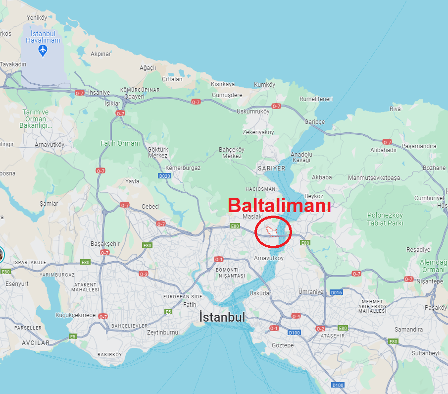

## 1849 📅 🧭 Convention 🌍 Baltalimanı

<!-- u:u00305 kind:text -->
1849-04-19    J 📅 G    1849-05-01

<!-- u:u00306 kind:quad -->
Balta-Liman Convention
The year 1849 marked significant changes in the governance of the Danubian Principalities, influenced by the broader context of the failed revolutions of 1848. Following these revolutionary upheavals, the Balta-Liman Convention was signed in May 1849 between the Ottoman Empire and Russia, seeking to stabilize the region. This convention aimed to reassert control and order in Wallachia and Moldova, appointing new rulers for both principalities while ensuring they remained under the suzerainty of the Ottoman Empire with Russian oversight. The convention stipulated a seven-year term for the new rulers and emphasized the need for a semblance of stability and reform to prevent future uprisings.
Grigore Alexandru Ghica V, who was in Paris during the revolutionary events, emerged as a key figure supporting liberal and nationalist ideals. From his position in exile, Ghica actively opposed the autocratic rule of his uncle, Mihail Sturdza, who had suppressed the revolution in Moldova. He penned a memoir to Talaat Efendi, an important Ottoman official, outlining the oppressive measures taken by Sturdza and advocating for political and social reforms aligned with the revolutionary spirit of 1848. Ghica's efforts highlighted his commitment to the principles of liberty, national identity, and governance reform, resonating with the liberal movements sweeping across Europe.
Ghica's advocacy and liberal stance caught the attention of influential political figures, including Mustafa Reșid Pașa, the Grand Vizier of the Ottoman Empire, known for his progressive views. Recommended by Reșid Pașa, Grigore Alexandru Ghica V was appointed as the new ruler of Moldova for a seven-year term, beginning in 1849 and concluding in 1856. His appointment was in line with the Balta-Liman Convention's objectives to stabilize the region and implement reforms. As ruler, Ghica was expected to navigate the delicate balance between Ottoman suzerainty and Russian influence while addressing the aspirations for reform and modernization that had fueled the previous year's revolution.

<!-- u:u00308 kind:quad -->
Where is Balta-Liman?
Baltalimanı, a historical neighborhood near Istanbul (formerly Constantinople), holds a significant place in history due to its strategic and political importance. Its name, meaning "Axe Port," reflects its past role as a crucial port for preparing ships that participated in the sieges of Constantinople. This area gained additional historical prominence through the signing of two notable conventions. In 1838, the United Kingdom and the Ottoman Empire also signed a trade convention here, which marked a pivotal moment in Anglo-Ottoman relations.

<!-- u:u00309 kind:figure -->

*Figure 77: 🧭 Baltalimanı 🌍 Istanbul 📅 Today*
