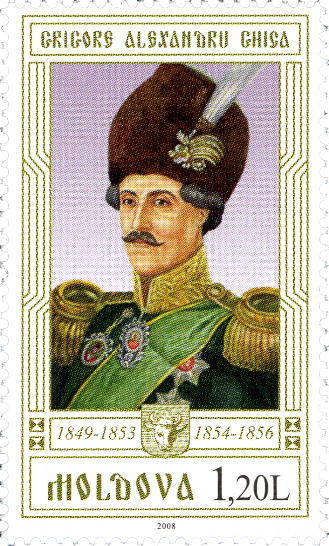
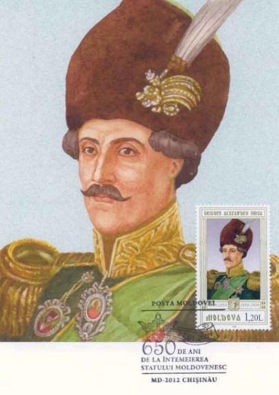
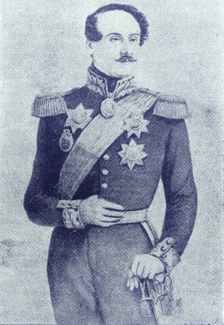

## 1849 📅 Grigore Ghica 🌍 Moldavia

<!-- u:u00313 kind:table -->

| Prince Grigore Alexandru Ghica V of Moldova was a member of the noble Ghica family (sometimes spelled Ghika), a well-renowned family. He had a distinguished career in public service, starting as an officer in the Moldavian army and eventually becoming the hatman, or leader, of the army. By 1842, he was the Secretary of State, and in 1843, he became the Minister of Finance. A supporter of the 1848 revolutionary movement, he became the Prince of Moldova for a seven-year term following the Balta Liman Convention. His reign, from 1849 to 1856, was marked by numerous liberal reforms. He emancipated the gypsies, abolished press censorship, improved education, and promoted national culture. He organized the publication of G. Șincai's three-volume chronicle, facilitated the return of exiled revolutionary leaders, and included notable figures like Mihail Kogălniceanu, Vasile Alecsandri, Costache Negri, Grigore Cuza, Alexandru Ioan Cuza, and Alecu Russo in the government. | Domnitorul Grigore Alexandru Ghica al V-lea al Moldovei a fost membru al familiei nobiliare Ghica (uneori ortografiată Ghika), o familie renumită. A avut o carieră distinsă în serviciul public, începând ca ofițer în armata moldovenească și devenind în cele din urmă hatmanul, sau conducătorul armatei. În 1842, a fost secretar de stat, iar în 1843 a devenit ministru de finanțe. Susținător al mișcării revoluționare de la 1848, a devenit principe al Moldovei pentru un mandat de șapte ani, în urma Convenției de la Balta Liman. Domnia sa, din 1849 până în 1856, a fost marcată de numeroase reforme liberale. A emancipat țiganii, a abolit cenzura presei, a îmbunătățit educația și a promovat cultura națională. A organizat publicarea cronicii în trei volume a lui G. Șincai, a facilitat întoarcerea liderilor revoluționari exilați și a inclus în guvern personalități precum Mihail Kogălniceanu, Vasile Alecsandri, Costache Negri, Grigore Cuza, Alexandru Ioan Cuza și Alecu Russo. |  |
|---|---|---|
| Figure 78: 📖 MI MD 629 | Figure 79: FDC ✉ 📖 MI MD 629 | Figure 80: Grigore Alexandru Ghica V |
| Le prince Grigore Alexandru Ghica V de Moldavie était membre de la noble famille Ghica (parfois orthographiée Ghika), une famille bien connue. Il a mené une brillante carrière dans la fonction publique, en commençant comme officier dans l'armée moldave et en devenant finalement le chef de l'armée. En 1842, il est secrétaire d'État et, en 1843, il devient ministre des finances. Partisan du mouvement révolutionnaire de 1848, il devient prince de Moldavie pour un mandat de sept ans à la suite de la convention de Balta Liman. Son règne, de 1849 à 1856, est marqué par de nombreuses réformes libérales. Il émancipe les tziganes, abolit la censure de la presse, améliore l'éducation et promeut la culture nationale. Il organise la publication de la chronique en trois volumes de G. Șincai, facilite le retour des dirigeants révolutionnaires exilés et fait entrer au gouvernement des personnalités comme Mihail Kogălniceanu, Vasile Alecsandri, Costache Negri, Grigore Cuza, Alexandru Ioan Cuza et Alecu Russo. | Fürst Grigore Alexandru Ghica V. von Moldawien war ein Mitglied der adligen Familie Ghica (manchmal auch Ghika geschrieben), einer sehr angesehenen Familie. Er machte eine steile Karriere im öffentlichen Dienst, begann als Offizier in der moldawischen Armee und wurde schließlich zum Oberbefehlshaber der Armee. Bis 1842 war er Staatssekretär, und 1843 wurde er Finanzminister. Als Anhänger der revolutionären Bewegung von 1848 wurde er nach der Balta-Liman-Konvention für eine siebenjährige Amtszeit Fürst der Republik Moldau. Seine Regierungszeit von 1849 bis 1856 war von zahlreichen liberalen Reformen geprägt. Er emanzipierte die Zigeuner, schaffte die Pressezensur ab, verbesserte das Bildungswesen und förderte die nationale Kultur. Er organisierte die Veröffentlichung der dreibändigen Chronik von G. Șincai, erleichterte die Rückkehr der im Exil lebenden Revolutionsführer und nahm namhafte Persönlichkeiten wie Mihail Kogălniceanu, Vasile Alecsandri, Costache Negri, Grigore Cuza, Alexandru Ioan Cuza und Alecu Russo in die Regierung auf. |  |
