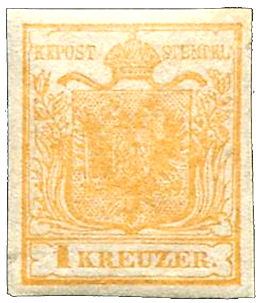
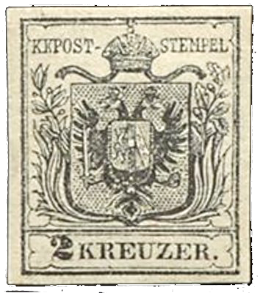
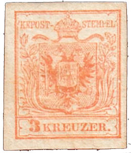
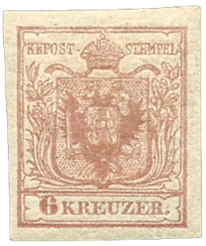
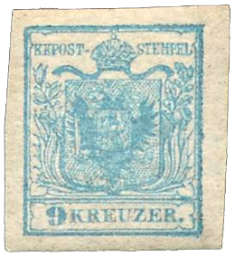

## 1850 📅 First Austrian Postage Stamp 🌍 Austrian Empire

<!-- u:u00315 kind:text -->
1850-05-20    J 📅 G    1850-06-01

<!-- u:u00316 kind:table -->

| First Austrian Postage Stamp April 6, 1850: The Austro-German Postal Union agreement was concluded between the Austro-Hungarian Empire and Prussia, aiming to create a uniform system of postal rates across their territories.  June 1, 1850: The Austrian Empire issued its first adhesive postage stamps, featuring the Austrian coat of arms. These stamps were used across the empire, which included modern-day Austria, Hungary, Slovakia, the Czech Republic, parts of northern Italy, Ukraine, southern Poland, Romania, and parts of the former Yugoslavia. However, the Italian territories of Lombardy and Venetia used different stamps due to their own currency system. July 1, 1850: The Austro-German Postal Union came into effect, establishing a standardized postal system between the Austro-Hungarian Empire and Prussia. This allowed for consistent postal rates and smoother communication across borders. | Primul timbru poștal austriac 6 aprilie 1850: Acordul de uniune poștală austro-germană a fost încheiat între Imperiul Austro-Ungar și Prusia, cu scopul de a crea un sistem uniform de tarife poștale pe teritoriile lor.  1 iunie 1850: Imperiul Austriac a emis primele sale timbre poștale adezive, care prezentau stema Austriei. Aceste timbre au fost utilizate pe întreg teritoriul imperiului, care includea Austria de astăzi, Ungaria, Slovacia, Republica Cehă, părți din nordul Italiei, Ucraina, sudul Poloniei, România și părți din fosta Iugoslavie. Cu toate acestea, teritoriile italiene Lombardia și Veneția foloseau timbre diferite datorită propriului sistem monetar. 1 iulie 1850: Uniunea Poștală Austro-Germană a intrat în vigoare, stabilind un sistem poștal standardizat între Imperiul Austro-Ungar și Prusia. Acest lucru a permis stabilirea unor tarife poștale consecvente și o comunicare mai fluentă peste granițe. |  |  |  |
|---|---|---|---|---|
| 📖 MI AT |  |  |  |  |
|  |  |  |  |  |
| Figure 81: 1XbI | Figure 82: 2XaI | Figure 83: 3XaI | Figure 84: 4XaI | Figure 85: 5XaI |
| Premier timbre-poste autrichien 6 avril 1850 : L'accord sur l'Union postale austro-allemande est conclu entre l'Empire austro-hongrois et la Prusse, dans le but de créer un système uniforme de tarifs postaux sur l'ensemble de leurs territoires. 1er juin 1850 : L'Empire autrichien émet ses premiers timbres-poste adhésifs, ornés des armoiries autrichiennes. Ces timbres sont utilisés dans tout l'empire, qui comprend l'Autriche actuelle, la Hongrie, la Slovaquie, la République tchèque, une partie de l'Italie du Nord, l'Ukraine, le sud de la Pologne, la Roumanie et une partie de l'ancienne Yougoslavie. Toutefois, les territoires italiens de Lombardie et de Vénétie utilisaient des timbres différents en raison de leur propre système monétaire. 1er juillet 1850 : L'Union postale austro-allemande entre en vigueur, établissant un système postal normalisé entre l'Empire austro-hongrois et la Prusse. Cela permet d'appliquer des tarifs postaux cohérents et de faciliter les communications transfrontalières. | Erste österreichische Briefmarke 6. April 1850: Der österreichisch-deutsche Postverein wird zwischen Österreich-Ungarn und Preußen geschlossen, um ein einheitliches Posttarifsystem für ihre Gebiete zu schaffen.  1. Juni 1850: Das österreichische Kaiserreich gibt seine ersten selbstklebenden Briefmarken mit dem österreichischen Wappen heraus. Diese Briefmarken wurden im gesamten Kaiserreich verwendet, das das heutige Österreich, Ungarn, die Slowakei, die Tschechische Republik, Teile Norditaliens, die Ukraine, Südpolen, Rumänien und Teile des ehemaligen Jugoslawiens umfasste. Die italienischen Territorien Lombardei und Venetien verwendeten jedoch aufgrund ihres eigenen Währungssystems andere Briefmarken. 1. Juli 1850: Der Österreichisch-Deutsche Postverein trat in Kraft und führte ein einheitliches Postsystem zwischen Österreich-Ungarn und Preußen ein. Dies ermöglichte einheitliche Posttarife und eine reibungslosere Kommunikation über die Grenzen hinweg. |  |  |  |
