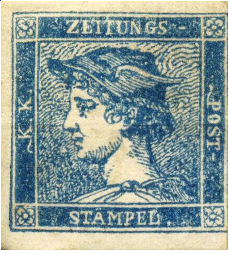
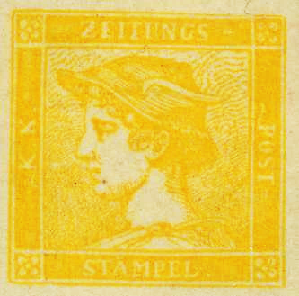
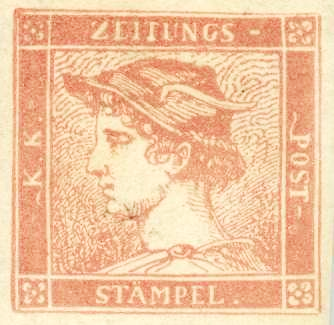

## 1851 📅 First 📰 Newspaper Stamp 🌍 Austrian Empire

<!-- u:u00318 kind:text -->
1850-12-20    J 📅 G    1851-01-01

<!-- u:u00319 kind:table -->

| The First Newspaper Stamp Austria issued the world's first newspaper stamps in 1851, featuring a profile of Mercury, the Roman messenger god. These stamps were designed to allow the reduced-rate mailing of newspapers and magazines, promoting the circulation of printed media. The stamps were unique in that they were denomination-free—their value was indicated by the color, leading to the iconic philatelic terms such as "Red Mercury," "Blue Mercury," and so on. Unlike regular postage stamps, these "Mercuries" had a distinctive square format, setting them apart both in design and function. | Primul timbru poștal pentru ziare În 1851, Austria a emis primele timbre pentru ziare din lume, cu profilul lui Mercur, zeul mesager roman. Aceste timbre au fost concepute pentru a permite expedierea cu tarif redus a ziarelor și revistelor, promovând astfel circulația presei scrise. Timbrele erau unice prin faptul că nu aveau valoare nominală - valoarea lor era indicată de culoare, ceea ce a dus la apariția unor termeni filatelici emblematici precum „Mercur roșu”, „Mercur albastru” etc. Spre deosebire de timbrele poștale obișnuite, aceste „Mercurii” aveau un format pătrat distinctiv, care le deosebea atât prin design, cât și prin funcție. |  |
|---|---|---|
| 📖 MI AT |  |  |
|  |  |  |
| Figure 86: 6II 0.6 Kreuzer 📰 x 1 | Figure 87: 7Ia 6 Kreuzer 📰 x 10 | Figure 88: 8Ia 30 Kreuzer 📰 x 50 |
| Le premier timbre-poste de journal En 1851, l'Autriche a émis les premiers timbres de presse au monde, représentant le profil de Mercure, le dieu messager romain. Ces timbres ont été conçus pour permettre l'envoi à tarif réduit de journaux et de magazines, afin de promouvoir la circulation de la presse écrite. Ces timbres étaient uniques en ce sens qu'ils n'avaient pas de valeur nominale : leur valeur était indiquée par la couleur, ce qui a donné naissance aux termes philatéliques emblématiques tels que « Mercure rouge », « Mercure bleu », etc. Contrairement aux timbres-poste ordinaires, ces « Mercure » avaient un format carré distinctif, ce qui les distinguait à la fois par leur conception et par leur fonction. | Die erste Zeitungsbriefmarke Österreich gab 1851 die ersten Zeitungsmarken der Welt heraus, die das Profil von Merkur, dem römischen Botengott, zeigten. Diese Briefmarken sollten den verbilligten Versand von Zeitungen und Zeitschriften ermöglichen und so die Verbreitung von Printmedien fördern. Die Briefmarken waren insofern einzigartig, als sie keinen Nennwert hatten - ihr Wert wurde durch die Farbe angegeben, was zu den ikonischen philatelistischen Begriffen wie „Roter Merkur“, „Blauer Merkur“ usw. führte. Im Gegensatz zu normalen Briefmarken hatten diese „Merkur“-Marken ein unverwechselbares quadratisches Format, das sich sowohl in der Gestaltung als auch in der Funktion von anderen abhob. |  |
