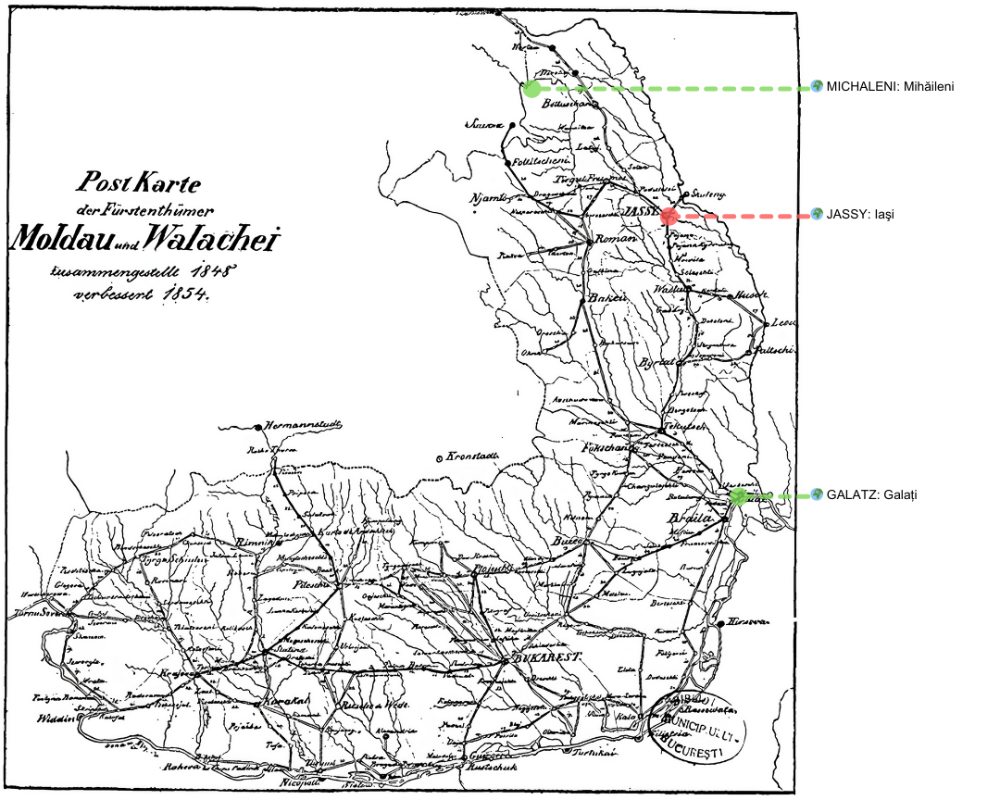

## 1852 📅 🧭 📯 New postal route 🌍 Moldavia

<!-- u:u00321 kind:text -->
1852-01-01    J 📅 G    1852-01-13

<!-- u:u00322 kind:table -->
| New postal route 🌍 Moldavia On January 1, 1852, the round-trip postal routes Mihăileni–Iași and Iași–Galați were opened, proposed and debated in the Moldavian Divan a year earlier by Teodor Ghica and Nicolae Milo. They improved deliveries between northern and southern Moldova. | Noua rută poştală 🌍 Moldova La 1 ianuarie 1852 au fost deschise rutele poștale dus-întors Mihăileni–Iași și Iași–Galați, propuse și dezbătute în Divanul Moldovei cu un an înainte de Teodor Ghica și Nicolae Milo. Acestea au îmbunătățit livrările între nordul și sudul Moldovei. |
|---|---|

<!-- u:u00323 kind:figure -->

*Figure 89: 🧭 New postal route 🌍 Moldavia 📅 1852*

<!-- u:u00325 kind:table -->
| Nouvelle route postale 🌍 Moldavie Le 1er janvier 1852, les routes postales aller-retour Mihăileni–Iași et Iași–Galați ont été ouvertes, proposées et débattues un an plus tôt au Divan de Moldavie par Teodor Ghica et Nicolae Milo. Elles ont amélioré les livraisons entre le nord et le sud de la Moldavie. | Neue Postroute 🌍 Moldau Am 1. Januar 1852 wurden die Hin- und Rück-Postrouten Mihăileni–Iași und Iași–Galați eröffnet, ein Jahr zuvor von Teodor Ghica und Nicolae Milo im moldauischen Divan vorgeschlagen und diskutiert. Sie verbesserten die Zustellungen zwischen Nord- und Südmoldau. |
|---|---|

<!-- u:u00326 kind:text -->
Figure 94, p.114
