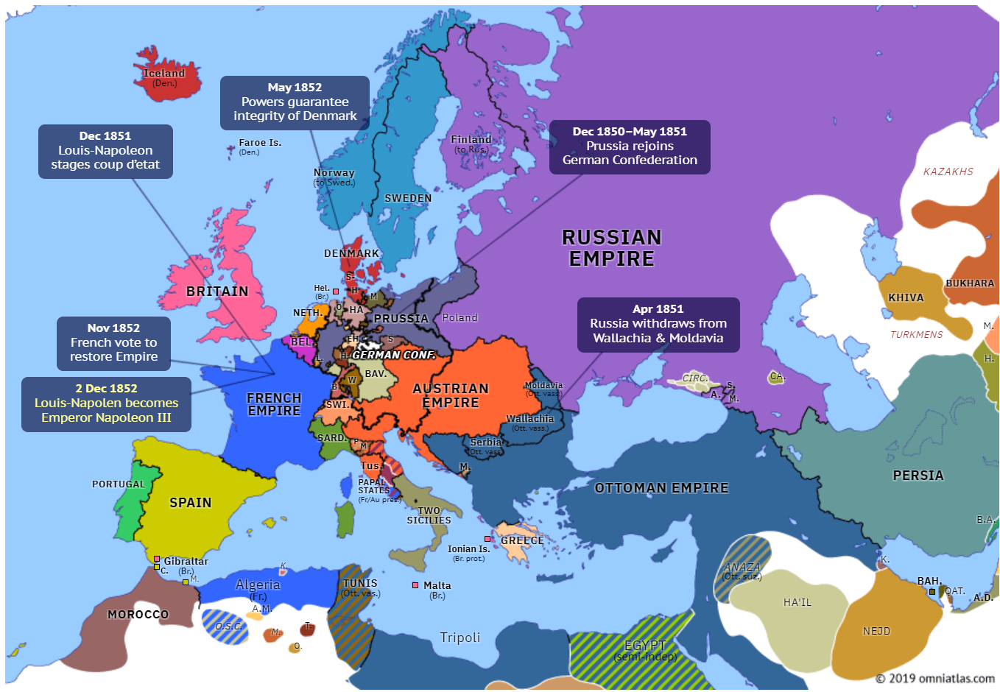
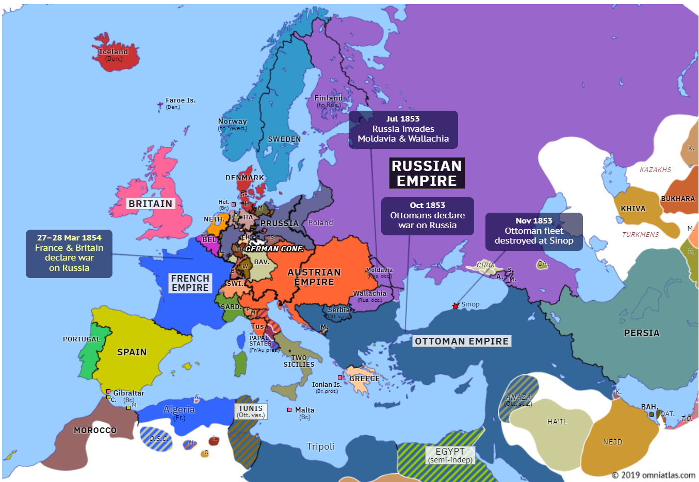

## 1853 📅 🧭 Crimean War begins 🌍 Wallachia, Moldavia

<!-- u:u00338 kind:quad -->
Crimean War begins
Mid-19th Century 📅 The balance of power in Europe is threatened by the declining Ottoman Empire, referred to as the "sick man of Europe." This situation, known as the Eastern Question, creates tensions among the Great Powers.
1852 📅 A dispute over Christian minorities in Ottoman lands escalates, with Russia positioning itself as the protector of Orthodox Christians, while France supports Roman Catholics. A conflict over access to the Church of the Nativity in Bethlehem strains relations further.
February 1853 📅 Russian envoy Alexander Menshikov travels to Constantinople, demanding the Ottoman Sultan recognize Russia as the protector of Orthodox Christians.
May 1853 📅 Menshikov threatens to break off relations when the Ottoman Empire, encouraged by Britain and France, refuses his demands.
Mid-1853 📅 Russian troops move into the Danubian Principalities of Moldavia and Wallachia, which are under Ottoman control, to force Ottoman compliance.
October 4, 1853 📅 The Ottomans, declare war on Russia, marking the beginning of the Eastern War, later known as the Crimean War.

<!-- u:u00339 kind:figure -->

*Figure 90: 🧭 Europe 🌍 Russia withdraws from Wallachia and Moldova 📅 1851 – 1852*

<!-- u:u00341 kind:figure -->

*Figure 91: 🧭 Europe 🌍 Russia invades Wallachia and Moldova 📅 1853 – 1854*
