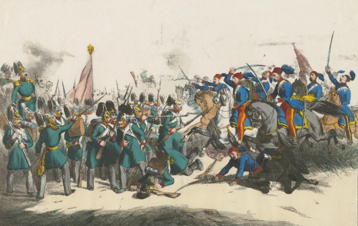
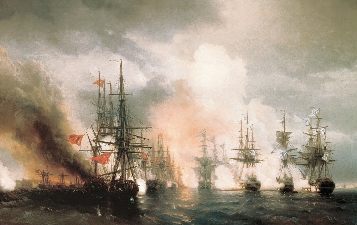

## 1853 📅 Exile of Ghica and Ştirbey 🌍 Wallachia, Moldavia  Vienna

<!-- u:u00344 kind:quad -->

Exile of Ghica and Ştirbey
October 1853 📅 As the Crimean War escalated, the rulers of the Romanian principalities, Barbu Știrbey of Wallachia and Grigore Ghica of Moldavia, were forced into exile in Vienna.
Tsar Nicholas I appointed a special governor, General Adjutant Budberg, to oversee the principalities, which came under Russian control during the summer of 1853. Baron Budberg was aided by two vicepresidents, Kalcinski in Bucharest and Uruzov in Iaşi.
November 1853 📅 The Battle of Oltenița was the first major engagement of the Crimean War. 
The Russian navy attacks the Ottoman fleet at Sinop, securing control of the Black Sea but inciting negative reactions in Britain and France.
