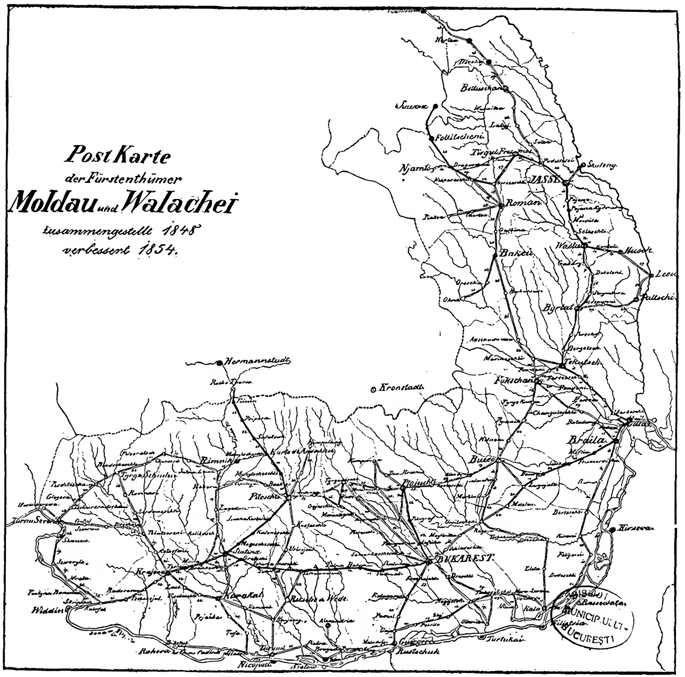

## 1854 📅 🧭 📯 Postal Routes 🌍 Moldavia & Wallachia

<!-- u:u00350 kind:quad -->
This rare map showing postal routes in the Danubian Principalities includes a statement that it was created in 1848 and revised in 1854, most likely during the Austrian occupation, by an Austrian official.

<!-- u:u00351 kind:figure -->

*Figure 94: 🧭 📯 Postal Routes 🌍 Moldavia & Wallachia 📅 1854*
