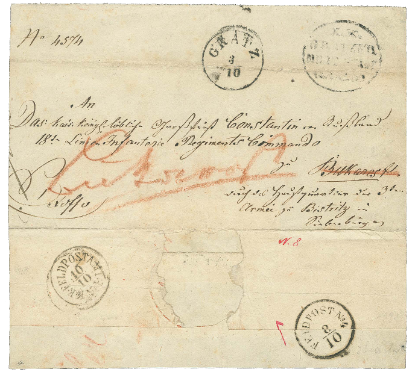
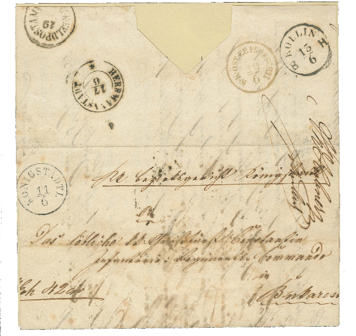

## 1854, 1855 📅 📯 ✉ Covers 🌍  Bucharest

<!-- u:u00369 kind:quad -->

✉ 1854 Cover
Sent from Gratz to Bucharest, featuring a FELDPOST No. 4 cancellation in transit at Bistritz (Bistrița) and an arrival datestamp FELDPOSTAMT No. 1 of Bucharest (Oct 10) in black.

✉ Scrisoare din 1854
Expediată din Gratz către București, cu o ștampilă FELDPOST No. 4 aplicată în tranzit la Bistritz (Bistrița) și o ștampilă de sosire FELDPOSTAMT No. 1 din București (10 octombrie) cu cerneală neagră.

✉ Lettre de 1854
Envoyée de Gratz à Bucarest, avec une oblitération FELDPOST No. 4 en transit à Bistritz (Bistrița) et un cachet d'arrivée FELDPOSTAMT No. 1 de Bucarest (10 octobre) en noir.

✉ Brief von 1854
Gesendet von Gratz nach Bukarest, mit einem FELDPOST No. 4-Stempel während des Transits in Bistritz (Bistrița) und einem Ankunftsstempel FELDPOSTAMT No. 1 von Bukarest (10. Oktober) in Schwarz.
⏭ 📖 Corinphila 186 📅 2014 - Europe A-Z

Lot 1109 💰 320 CHF
