## 1856 📅 📯 „Timbru Domnesc” 🌍 Iaşi (Jassy)

<!-- u:u00374 kind:quad -->
Princely Stamp
Introduced by Grigore Alexandru Ghica in 1856, the "Timbru Domnesc" was used intermittently over a relatively short but eventful period. It was officially removed from use on January 24/February 5, 1862, when Prince Alexandru Ioan Cuza solemnly proclaimed the definitive union of the Principalities of Moldova and Wallachia in a joint session of their Assemblies. Despite its official removal, the "Timbru Domnesc" continued to be used until June 1862. This seal witnessed the preparation, realization, and consolidation of the Union of the Romanian Principalities, Moldova, and Wallachia.
Additionally, the inscription with Latin letters on the "Timbru Domnesc" was a significant cultural symbol, representing the triumph of Latin writing in Romanian culture during that period. The "Timbru Domnesc" played a crucial role in chancery acts and served as a precursor to the fiscal stamp in Romania, marking a significant step in the administrative and cultural evolution of the Romanian territories.
Besides the fixed 20 Parale stamp, there was also a variant for a gradual Princely Stamp divided into to classes, Ist class of 2 to the thousand and the IInd class of 5 to the thousand.

<!-- u:u00375 kind:quad -->
Princely Stamp – Wet
The 20 Parale fixed value "Timbru Domnesc" issue from 1856 was printed on a 46x35.5cm paper and contained a "wet" stamp in the top left corner and a "dry" stamp underneath it. The wet stamp (29mm diameter) featured a central depiction of Justice holding a balance, an aurochs head and a value box inscribed with "20P". The words "Timbru domnesc" surround the central image, and the name of the engraver, J. Bessaignet is on the bottom.

<!-- u:u00376 kind:figure -->
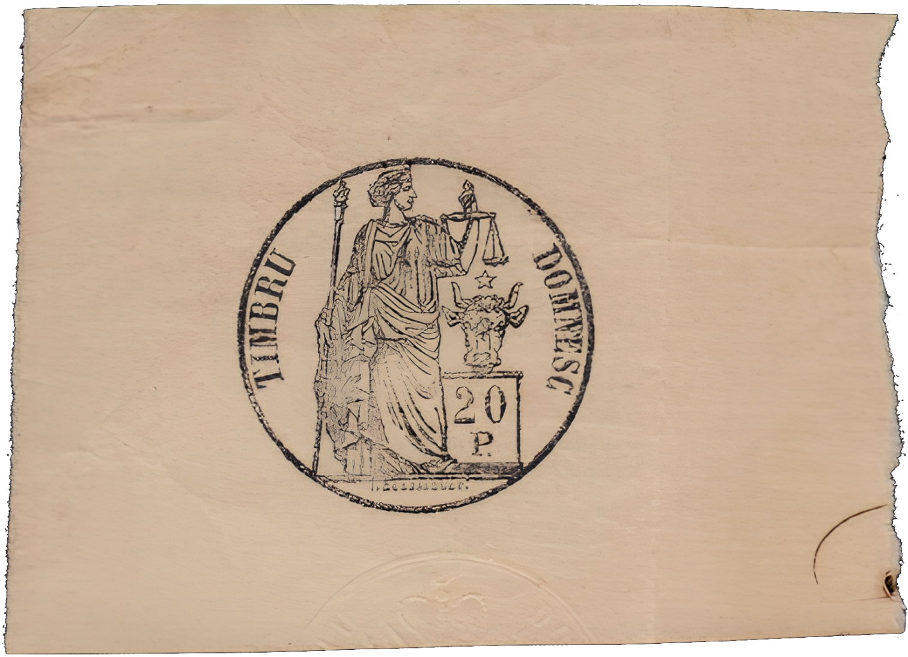

*Figure 97: Timbru Domnesc – Wet*

<!-- u:u00379 kind:quad -->
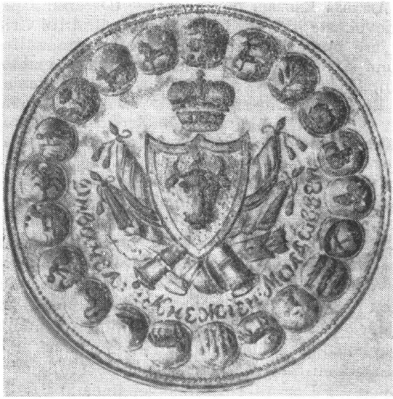

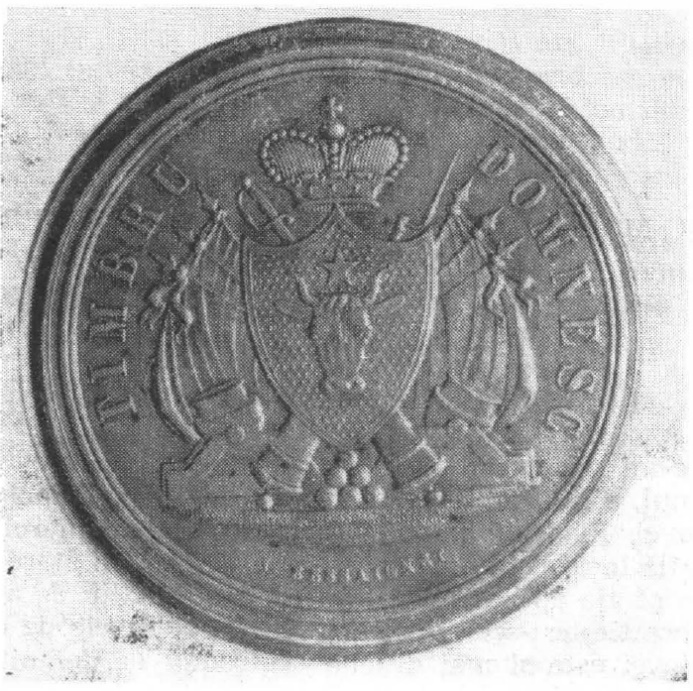

Princely Stamp – Dry
The seal, made of solid bronze, has a diameter of 30 mm. At the center, a shield displays the emblem of Moldova, featuring an auroch's head with a five-pointed star between its horns. Above the shield is a princely crown adorned with pearls. On either side of the shield, there are three flags. Beneath the shield, two cannons, two howitzers, and six spherical cannonballs are depicted. Above the shield, there is the hilt of a sword and the tip of a bayonet-equipped rifle. The inscription "TIMBRU DOMNESC" is located on the right and left sides in the exergue, and the engraver's name, J. Bessaignet, is at the bottom. The seal's outline is enclosed by two embossed circles.

<!-- u:u00380 kind:table -->
| Timbre princier – Sec Le sceau, en bronze massif, a un diamètre de 30 mm. Au centre, un bouclier porte l'emblème de la Moldavie, représentant une tête d'auroch avec une étoile à cinq branches entre les cornes. Au-dessus de l'écu se trouve une couronne princière ornée de perles. De chaque côté de l'écu se trouvent trois drapeaux. Sous l'écu, deux canons, deux obusiers et six boulets sphériques sont représentés. Au-dessus de l'écu, on peut voir la garde d'une épée et la pointe d'un fusil équipé d'une baïonnette. L'inscription « TIMBRU DOMNESC » se trouve à droite et à gauche dans l'exergue, et le nom du graveur, J. Bessaignet, se trouve en bas. Le contour du sceau est entouré de deux cercles en relief. | Fürstliche Briefmarke – Trocken Das Siegel ist aus massiver Bronze gefertigt und hat einen Durchmesser von 30 mm. In der Mitte befindet sich ein Schild mit dem Wappen der Republik Moldau, das einen Auerochsenkopf mit einem fünfzackigen Stern zwischen den Hörnern zeigt. Oberhalb des Schildes befindet sich eine mit Perlen besetzte Fürstenkrone. Zu beiden Seiten des Schildes befinden sich drei Flaggen. Unterhalb des Schildes sind zwei Kanonen, zwei Haubitzen und sechs kugelförmige Kanonenkugeln abgebildet. Oberhalb des Schildes befinden sich der Griff eines Schwertes und die Spitze eines Gewehrs mit Bajonett. Die Umschrift TIMBRU DOMNESC“ befindet sich rechts und links im Exergue, der Name des Graveurs, J. Bessaignet, steht am unteren Rand. Der Umriss des Siegels wird von zwei geprägten Kreisen umschlossen. |
|---|---|

<!-- u:u00381 kind:text -->
1857 📅 Timbru Domnesc

<!-- u:u00382 kind:table -->
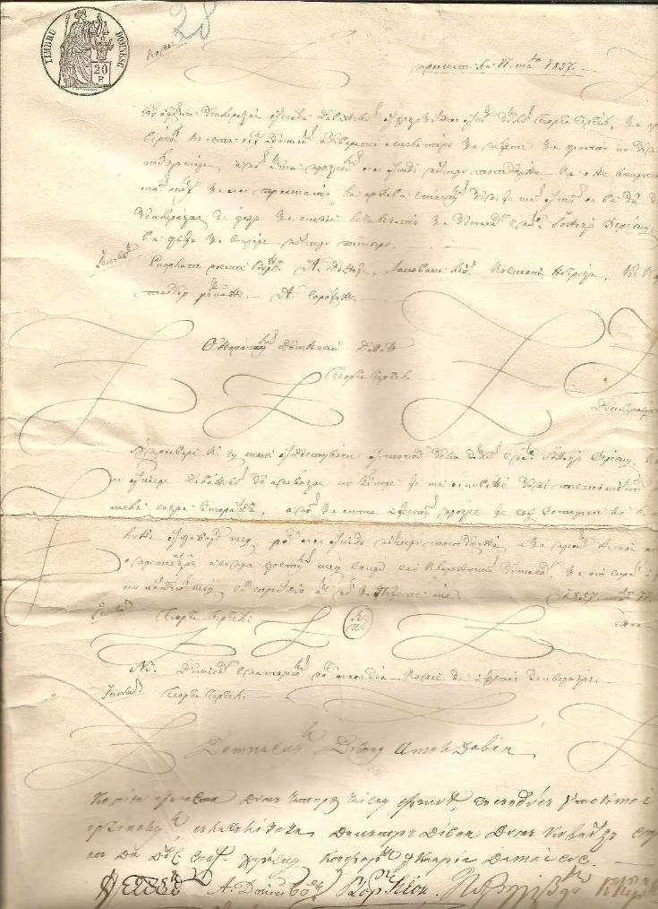

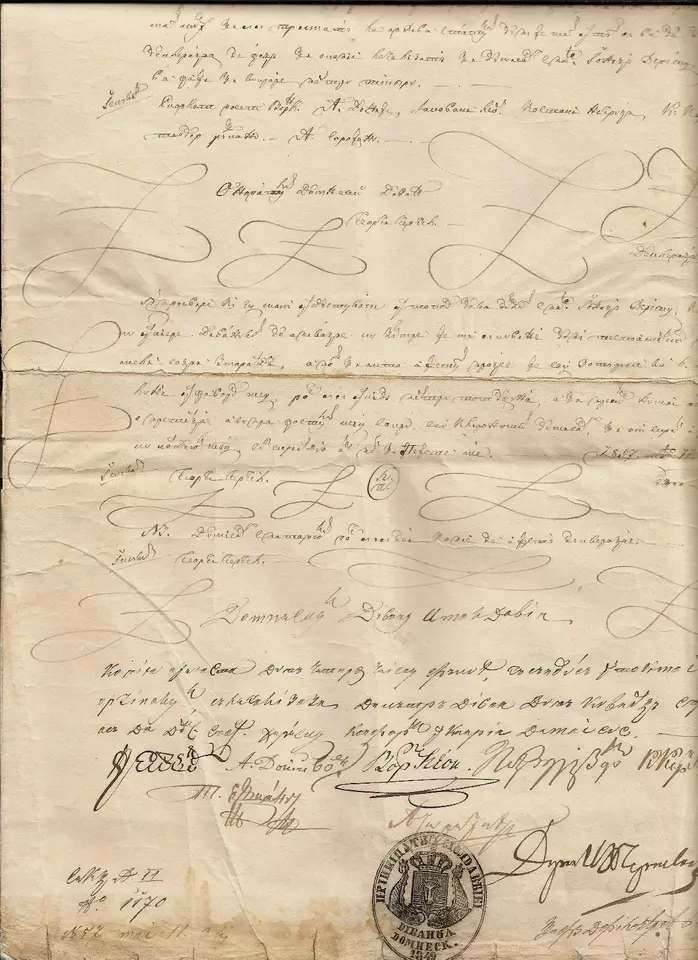

|  |  |
|---|---|

<!-- u:u00383 kind:text -->
✍The Z shape is used to cover empty space to prevent text from being added after the document has been completed.

<!-- u:u00385 kind:table -->
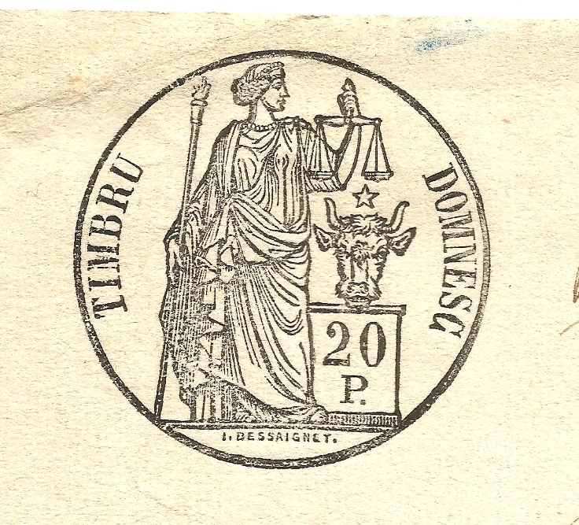

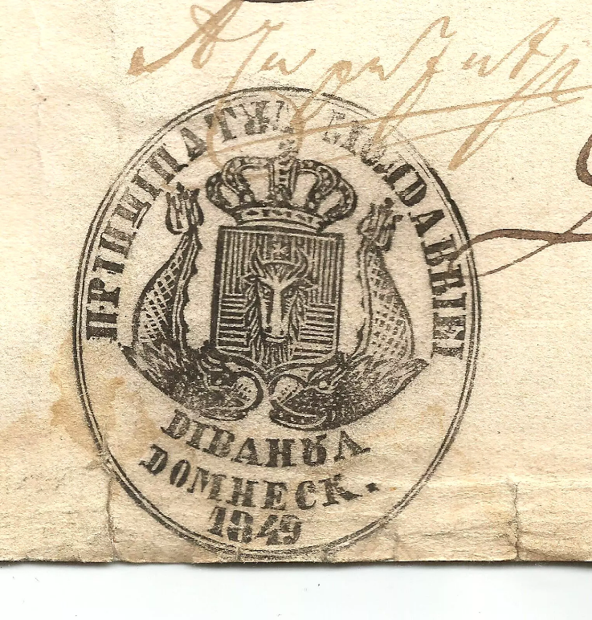

|  |  |
|---|---|

<!-- u:u00387 kind:figure -->
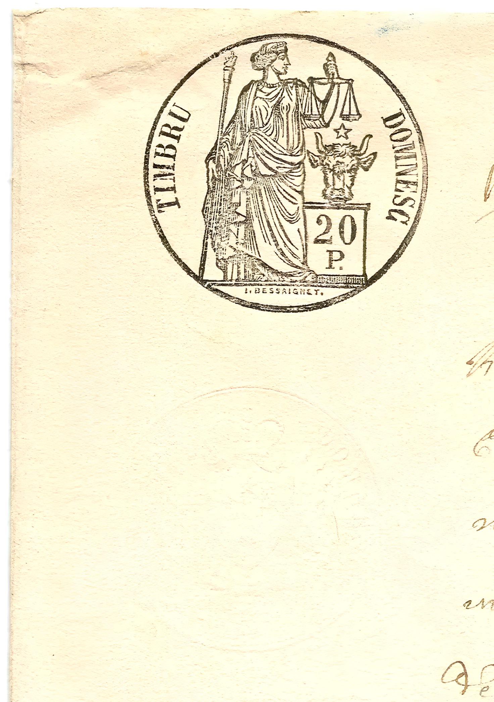

*Figure 101: 1857 📅 Timbru Domnesc – „Wet” and „Dry” stamps*

<!-- u:u00389 kind:text -->
XIXth Century 📅 Fiscal tax stamps 🌍 France

<!-- u:u00390 kind:figure -->
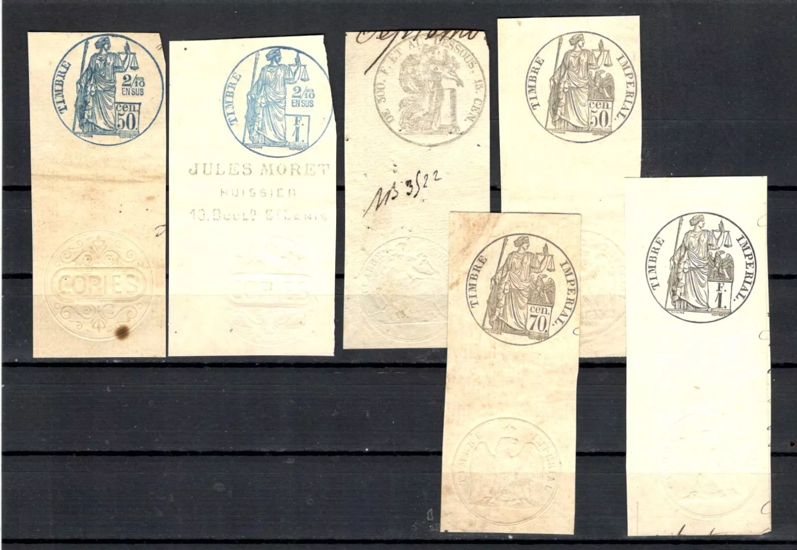

<!-- u:u00391 kind:figure -->
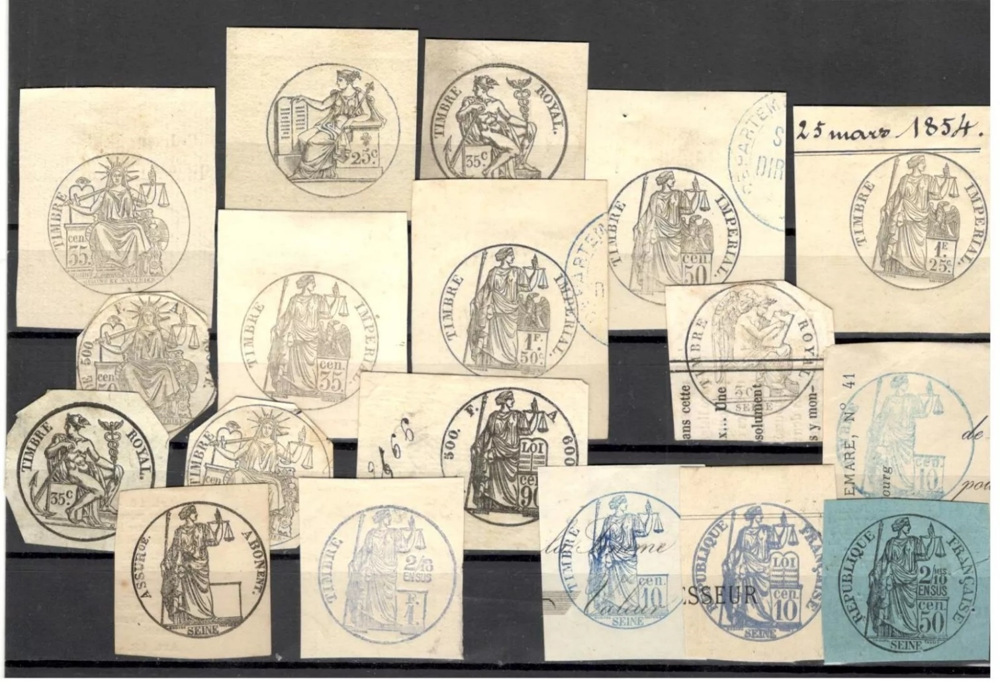

*Figure 102: XIXth Century 📅 Fiscal tax stamps 🌍 France*

<!-- u:u00394 kind:quad -->
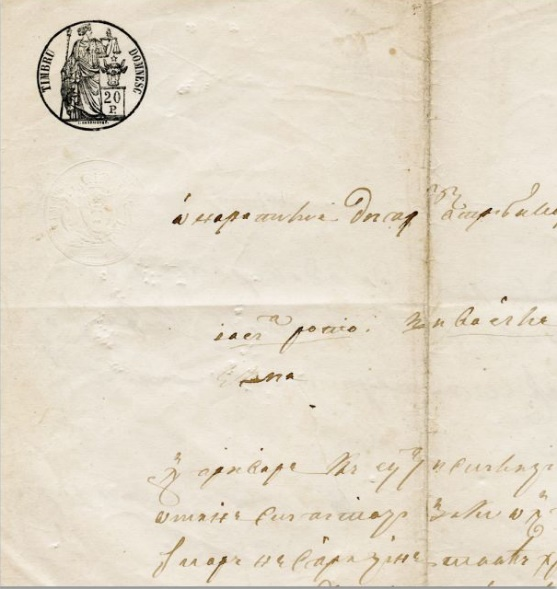

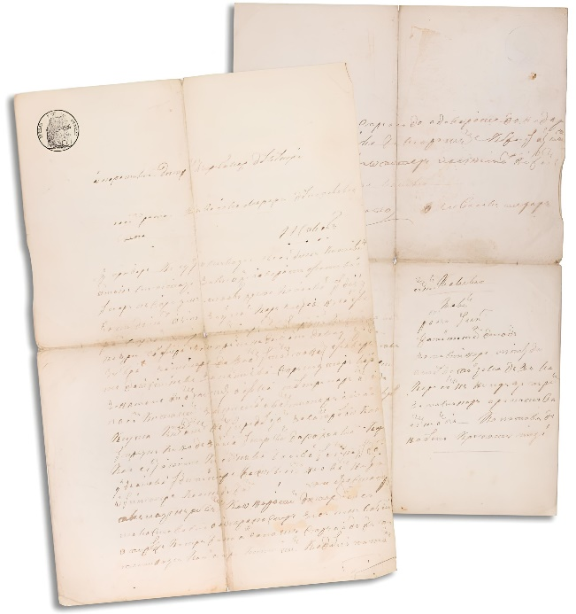

Stolen horses
A complaint submitted by Iosip Ratoi and Vasăli Morari from Iași to the Department of Internal Affairs regarding the theft of a pair of horses. The document was handwritten with black ink on one page, recto and verso. On the verso, the descriptions of the two horses were written.
Figure 103: Timbru Domnesc – Complaint regarding stolen horses
36 x 23cm | 14.17 x 9.03”
x2

<!-- u:u00395 kind:table -->
| Chevaux volés Plainte déposée par Iosip Ratoi et Vasăli Morari de Iași auprès du Département des affaires intérieures concernant le vol d'une paire de chevaux. Le document a été écrit à la main à l'encre noire sur une page, recto et verso. Au verso, les descriptions des deux chevaux sont écrites. | Gestohlene Pferde Anzeige von Iosip Ratoi und Vasăli Morari aus Iași beim Innenministerium wegen des Diebstahls eines Pferdegespanns. Das Dokument wurde handschriftlich mit schwarzer Tinte auf einer Seite, recto und verso, verfasst. Auf der Rückseite wurden die Beschreibungen der beiden Pferde vermerkt. |
|---|---|

<!-- u:u00397 kind:table -->
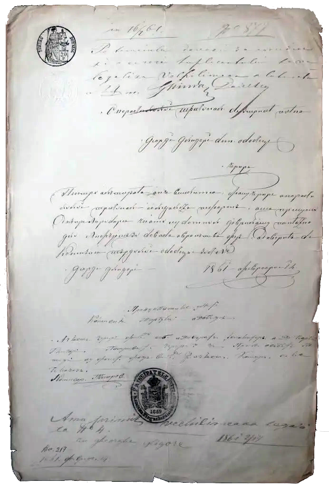

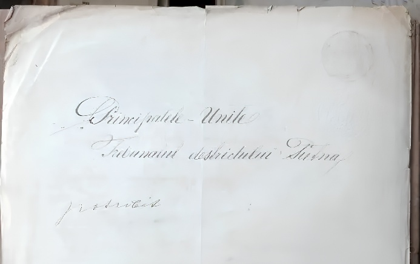

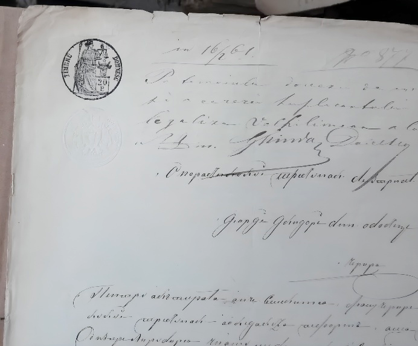

|  |  |
|---|---|
| Reverse |  |
