## 1856 📅 🧭 Treaty 🌍 Paris

<!-- u:u00400 kind:text -->
📅 G    1856-03-30

<!-- u:u00401 kind:quad -->
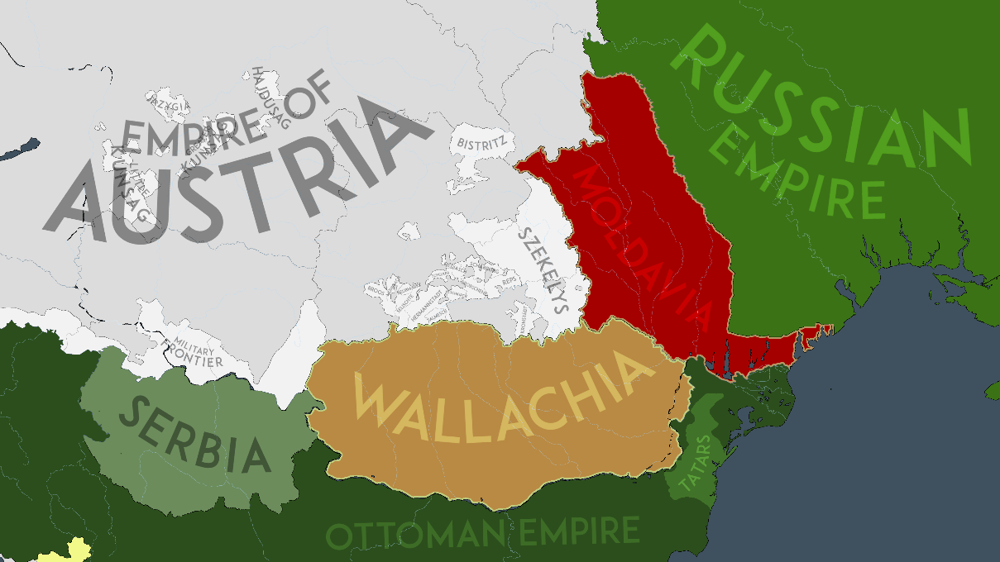

Treaty of Paris
The Crimean War (1853-1856) ended in a victory for the allied forces of France, Britain, the Ottoman Empire, and Sardinia against Russia. The war was primarily fought over control of the Holy Land and the balance of power in Europe, but it became infamous for the poor handling of military operations, which led to unnecessary suffering and loss of life. Despite military victories, the war was marked by wasteful mismanagement and negligence. Casualties from disease, exposure, and poor logistics far outnumbered those from actual combat. The conflict concluded with the Treaty of Paris in 1856, which severely restricted Russia's influence in Europe, particularly its access to the Black Sea and the Danube River.
Figure 105: 🧭 Treaty of Paris 🌍 Moldavia, Wallachia 📅 1856

<!-- u:u00402 kind:figure -->
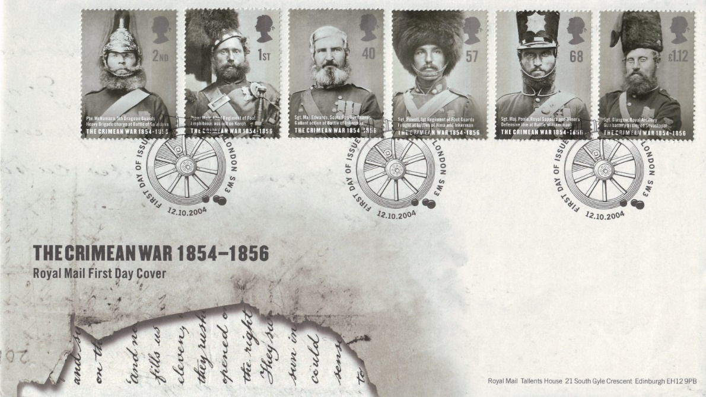

<!-- u:u00403 kind:table -->
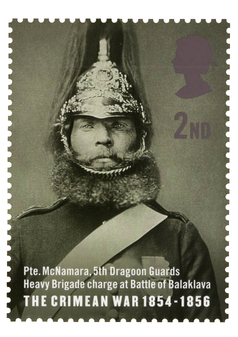

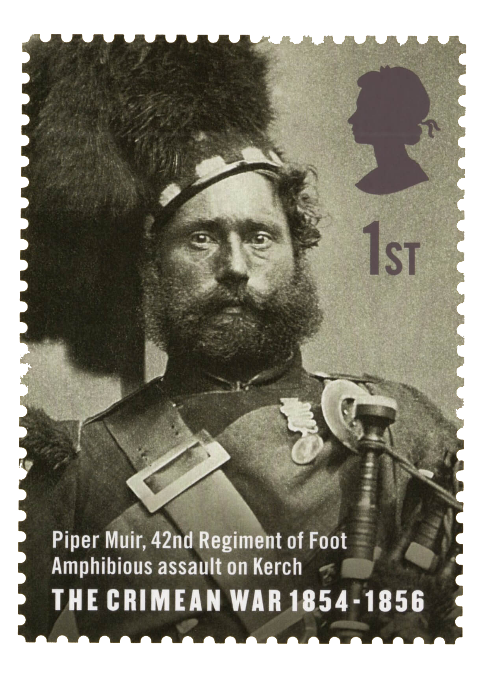

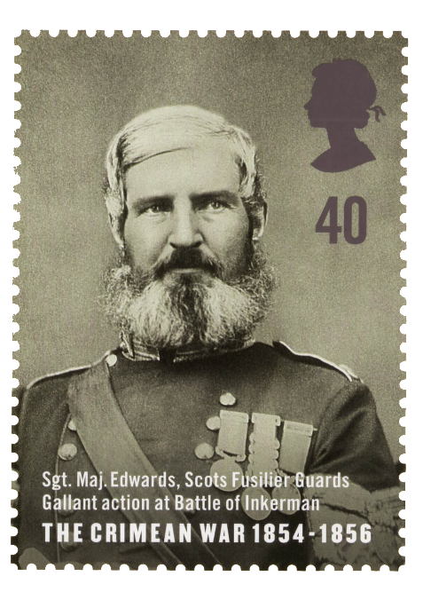

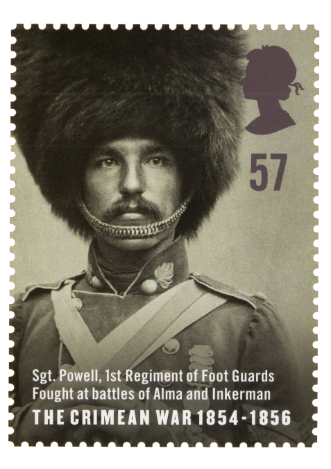

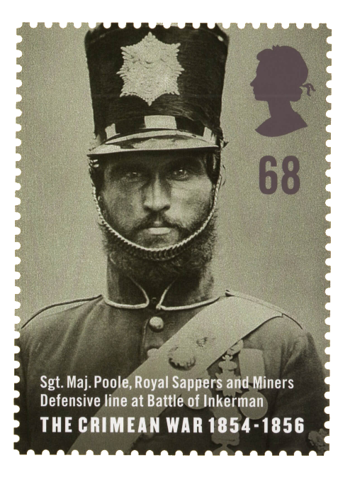

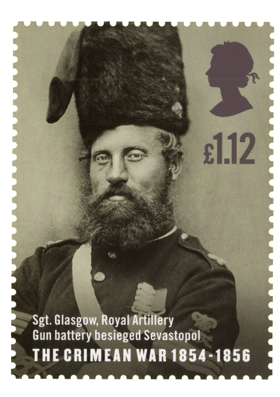

|  |  |  |
|---|---|---|
|  |  |  |

<!-- u:u00404 kind:text -->
Figure 106: ✉ FDC 📖 SG 2489 – 2494

<!-- u:u00405 kind:figure -->
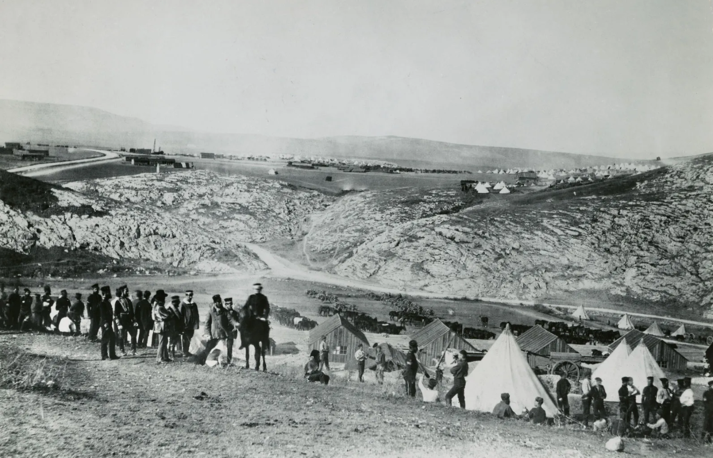

*Figure 107: Encampment of the Horse Artillery during the Crimean War 📅 1855*

<!-- u:u00407 kind:figure -->
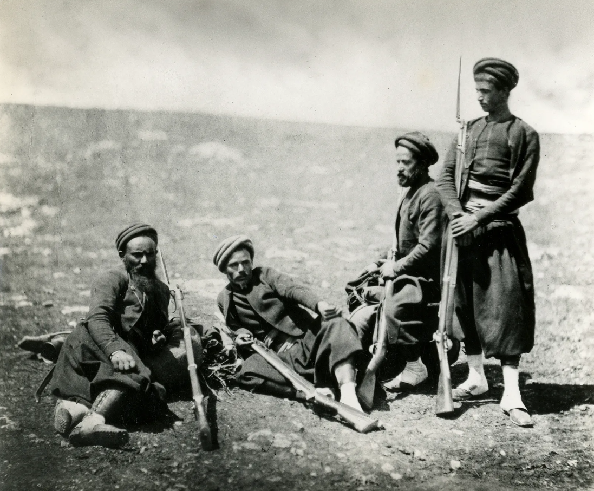

*Figure 108: Four Zouaves with their bayonetted rifles during the Crimean War 📅 1855*

<!-- u:u00409 kind:figure -->
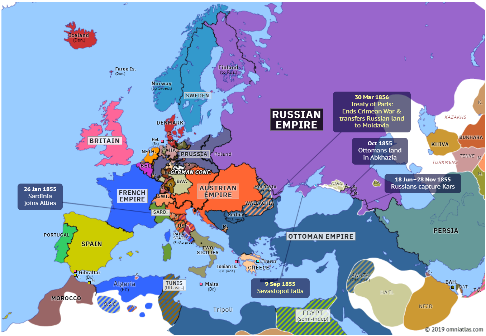

*Figure 109: 🧭 Treaty of Paris 🌍 Europe 📅 1856*

<!-- u:u00411 kind:figure -->
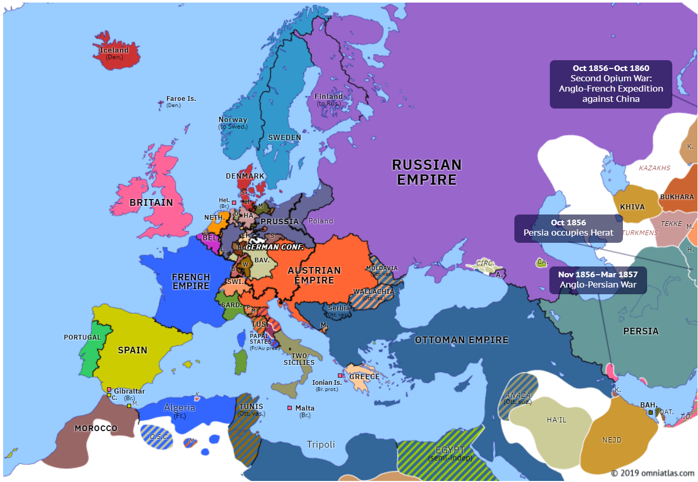

*Figure 110: 🧭 Europe 📅 1857*
