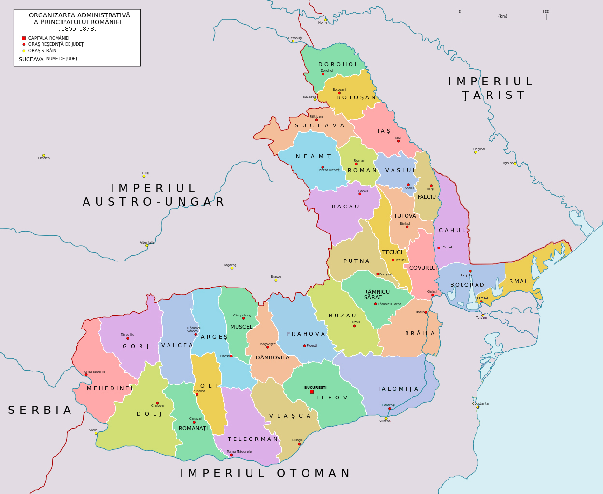

## 1856 📅 🧭 New Counties in Moldavia 🌍 Cahul, Bolgrad, Ismail

<!-- u:u00414 kind:quad -->
New Counties in Moldavia
After the Crimean War, Russia was forced to provide Southern Besserabia (Cahul, Bolgrad, and Ismail) to the Principality of Moldavia, largely to prevent its direct access to the Danube and weaken its influence in the region.

<!-- u:u00416 kind:figure -->

*Figure 111: 🧭 Counties 🌍 Moldavia, Wallachia 📅 1856 – 1878*
