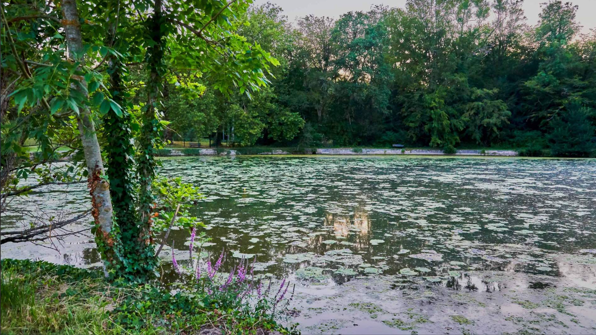
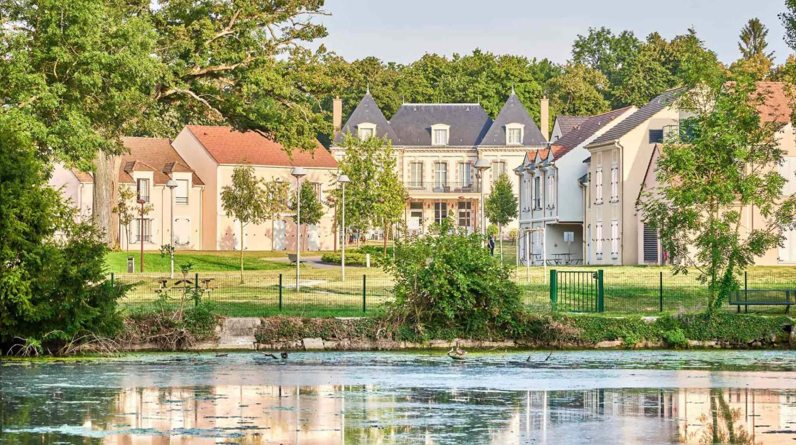
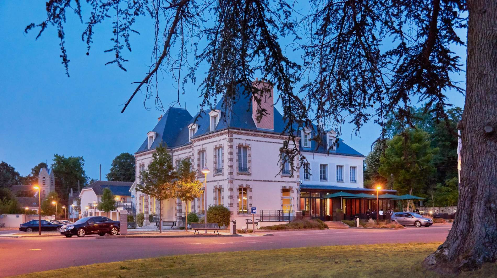
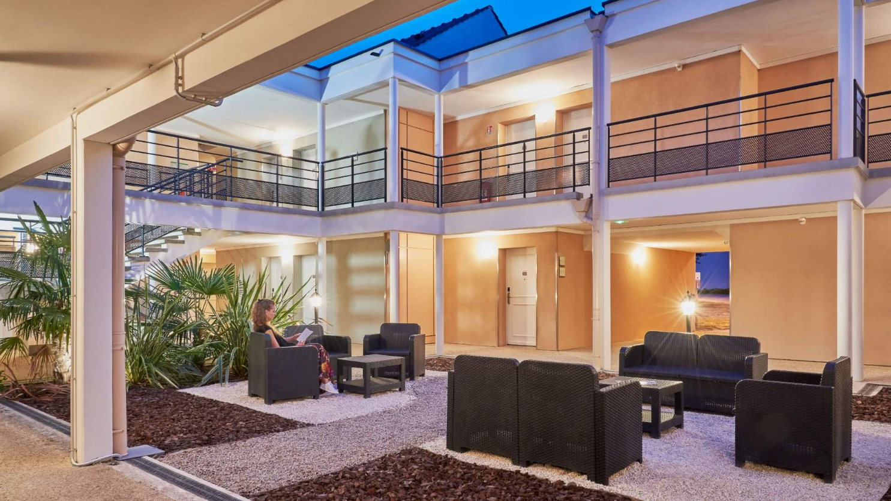
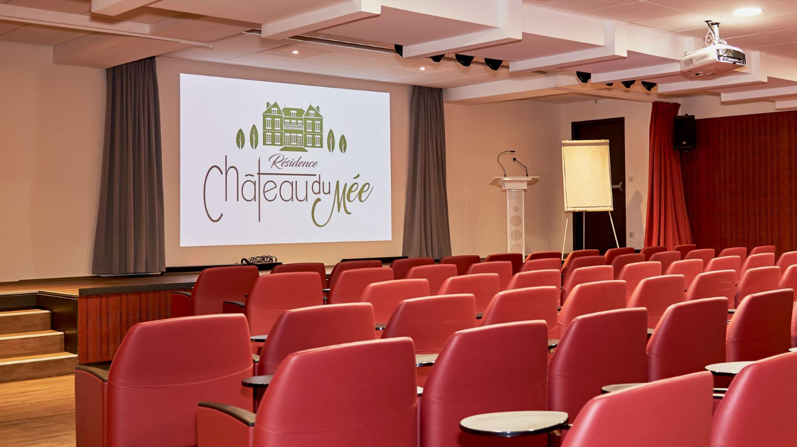
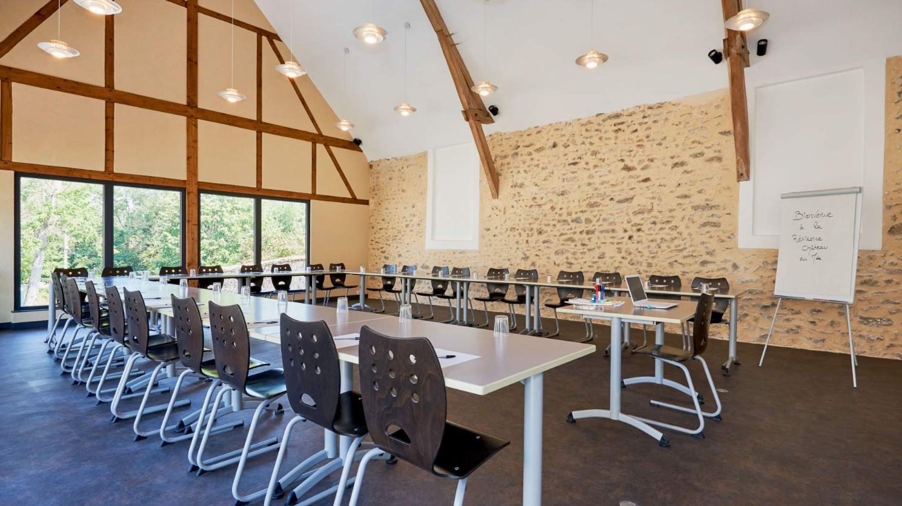
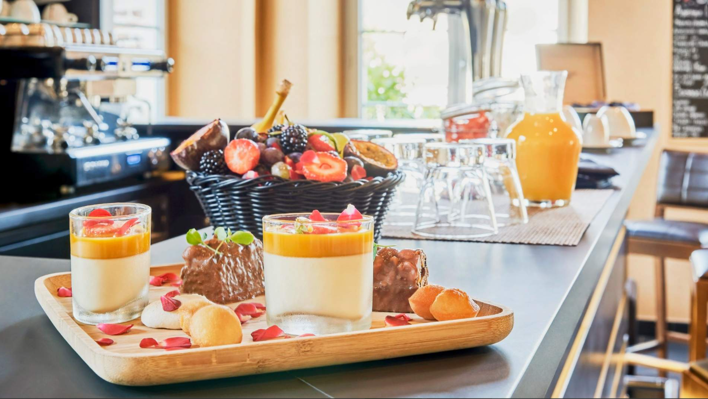
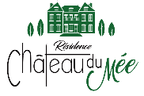

## 1857 📅 🧭 Ghica’s Exile 🌍 Paris

<!-- u:u00437 kind:quad -->
Ghica’s Exile
Grigore Ghica lived a complex personal and political life during his exile in Paris. He had two children, Grigore and Ferdinand, with Marie Prudence Euphrosine Leroy, his third wife whom he married on November 9, 1856. Despite his personal efforts to rebuild his life, Ghica remained deeply involved in the political struggles of his homeland. 
In 1857, the exposure of Vogoride’s manipulation shocked the European powers. Napoleon III of France, initially open to the idea of a partial union of the principalities under separate governments, was forced to reconsider his stance in light of the scandal. 
At the time, Ghica had been living in exile at his château, Le Mée, near Paris. In a bid to influence events, Ghica requested a meeting with Napoleon III, but the French emperor, wary of further entanglement, declined the audience.
Ghica attributed this refusal to the slanderous pamphlets that circulated after his fall from power, which tarnished his reputation. In reality, Napoleon’s refusal was motivated by a desire not to antagonize Britain, which opposed the union of Moldavia and Wallachia.
The series of disappointments weighed heavily on Ghica. On August 24, 1857, he took his own life at his château in Le Mée (now known as Le Mée-sur-Seine) by shooting himself in the head with a hunting rifle. 
His suicide was not only driven by Napoleon III’s refusal to meet with him, but also by the actions of Teodor Balș, who had convened a commission to investigate Ghica’s administrative and financial management during his reign. Adding to his despair was the publication of a defamatory pamphlet,  authored by a member of the nationalist party in 1856, which accused him of disgraceful thefts and malfeasance. 
He wrote in his will that „I am the victim of an abominable plot: though I am innocent, I cannot go on living. A day will come when the truth will come to light. I await my enemies at the tribunal of God.”

<!-- u:u00440 kind:quad -->

The Château du Mée, once the residence of Grigore Ghica, has been transformed into a charming hotel that offers a blend of historical elegance and modern luxury.
Figure 112: Résidence Château du Mée 📅 Today

<!-- u:u00441 kind:figure -->

*Figure 113: 🧭 Résidence Château du Mée 🌍 Le Mée-sur-Seine 📅 Today*

<!-- u:u00443 kind:table -->
| La Résidence Château du Mée, située aux portes de Paris dans la région pittoresque de la Seine-et-Marne, offre un séjour chaleureux et accueillant avec ses 224 appartements bien aménagés, conçus pour le confort et la tranquillité. Nichée dans un vaste parc de 7 acres, la résidence dispose d'espaces verts luxuriants et d'un étang serein, ce qui lui confère un environnement idyllique et paisible. | Die Résidence Château du Mée liegt vor den Toren von Paris in der malerischen Region Seine-et-Marne und bietet mit ihren 224 gut ausgestatteten Apartments, die auf Komfort und Ruhe ausgelegt sind, einen warmen und einladenden Aufenthalt. Eingebettet in einen weitläufigen, 7 Hektar großen Park mit üppigen Grünflächen und einem ruhigen Teich, bietet die Residenz eine idyllische und friedliche Umgebung. |
|---|---|
