## 1858 📅 Stamps 🌍 Europe 📖 MI

<!-- u:u00470 kind:table -->
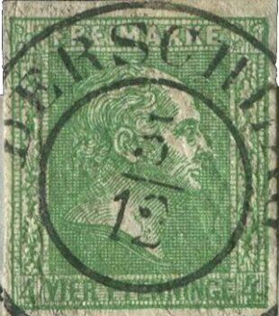

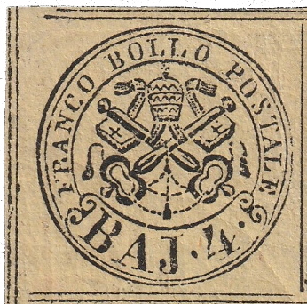

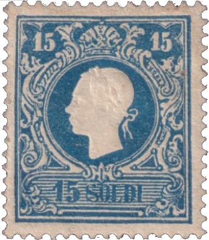

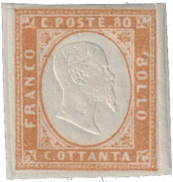

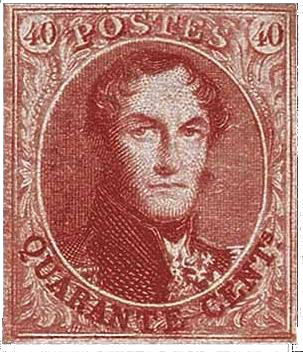

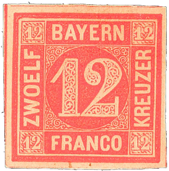

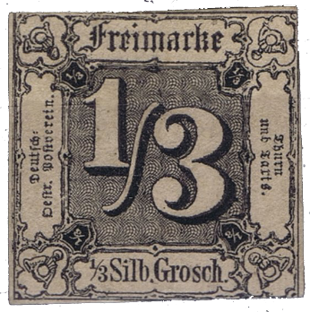

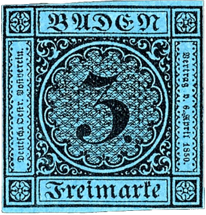

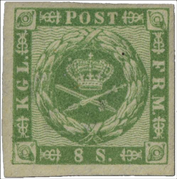

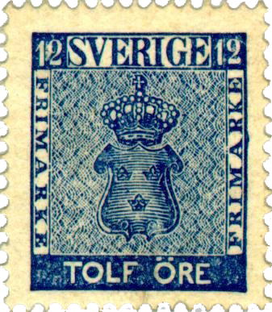

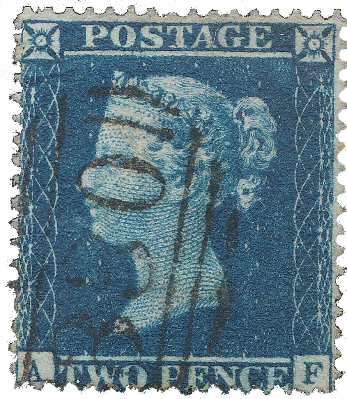

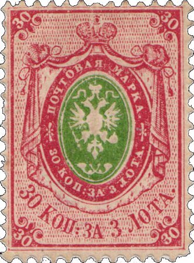

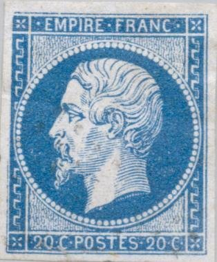

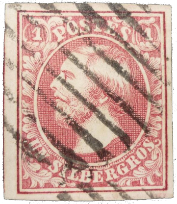

| 🌍 Prussia | 🌍 Papal States | 🌍 Lombardy-Venetia | 🌍 Sardinia-Piedmont |
|---|---|---|---|
|  |  |  |  |
| Figure 118: DE-PR 9b | Figure 119: IT-RS 5c | Figure 120: AT-LV 11I | Figure 121: IT-SA 14b |
|  |  |  |  |
| 🌍 Belgium | 🌍 Bavaria | 📯 Thurn and Taxis | 🌍 Baden |
|  |  |  |  |
| Figure 122: BE 9I | Figure 123: DE-BY 6 | Figure 124: DE-TT 2 | Figure 125: DE-BAD 8 |
|  |  |  |  |
| 🌍 Denmark | 🌍 Portugal | 🌍 Sweden | 🌍 United Kingdom |
|  |  |  |  |
| Figure 126: DK 8 | Figure 127: PT 11 | Figure 128: SE 9a | Figure 129: GB 11IIA |
|  |  |  |  |
| 🌍 Russia | 🌍 France | 🌍 Luxembourg | 🌍 Naples |
|  |  |  |  |
| Figure 130: RU 4x | Figure 131: FR 13Ie | Figure 132: LU 2f | Figure 133: IT-NA 1 |
