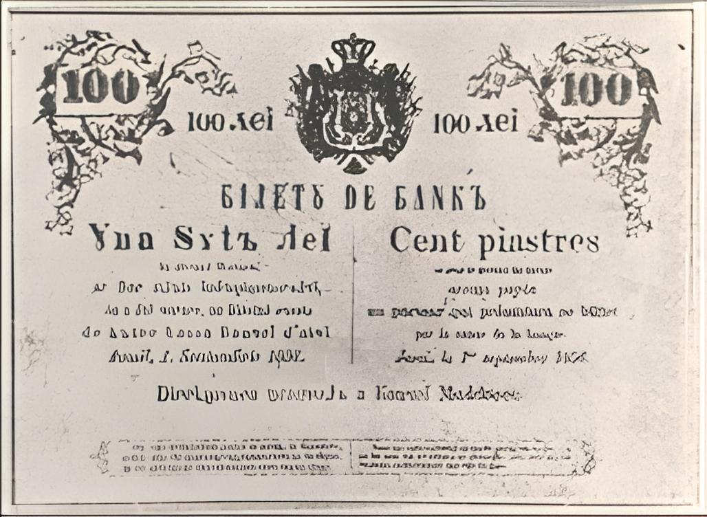
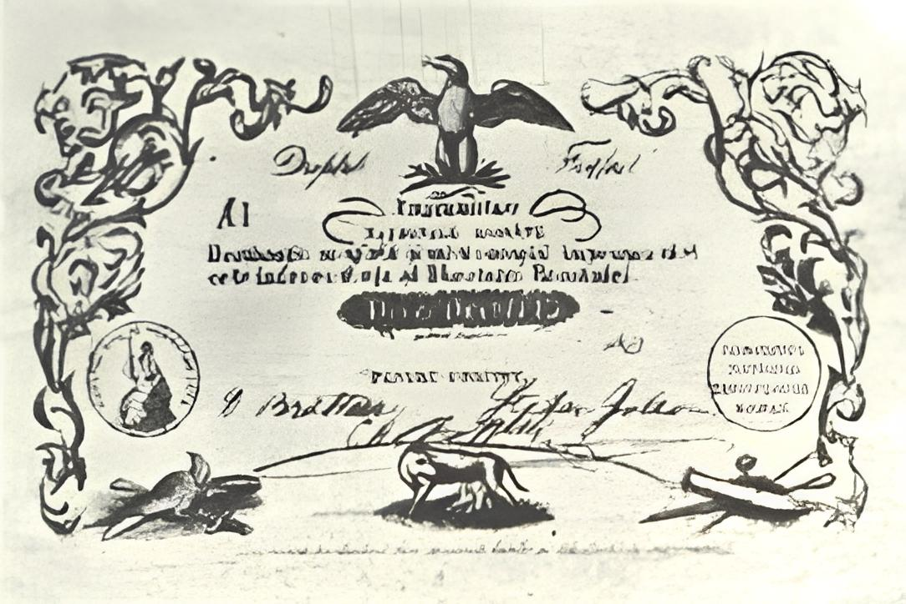

## 1858 📅 💰 Currency 🌍 Moldavia, Wallachia

<!-- u:u00473 kind:quad -->
Currency
A variety of coins from the Austrian Empire, Russian Empire, and Ottoman Empire circulated in the Danubian Principalities, reflecting the political and economic influence of these powers in the region.
One notable aspect of this period was the Romanian Leu, which existed solely as an accounting currency without a physical form until 1867. The Leu (meaning "lion") was inspired by the Dutch Leeuwendaalder, a widely circulated silver coin from the 16th and 17th centuries that depicted a lion. This coin also influenced the naming of the Bulgarian Lev (also meaning "lion"). Though the Leu was used in financial records and bookkeeping, it wouldn’t be minted as a physical coin until nearly a decade later.
📖 ZC mentions three banknotes issued before the first official coinage.
One example is the 100 lei (100 piastres) banknote, issued in 1856 by the Bank of Moldova (founded in 1852), which was never put into circulation.
Another example is the banknote issued in 1853 following a decision by the Romanian Revolutionary Committee, with a nominal value of 10 ducats. Although these loan notes were printed, they never entered circulation.
Despite the symbolic importance of the Leu, the Austrian gulden, Russian ruble, and Ottoman piastre (along with its subdivision, the para) were the dominant currencies in daily circulation.

<!-- u:u00474 kind:figure -->

*Figure 134: 100 Lei (Not Circulated) 💰 Bank of Moldova 📅 1856*

<!-- u:u00477 kind:figure -->

*Figure 135: 10 Ducati (Not Circulated) 💰 Romanian Revolutionary Comittee 🌍 Wallachia 📅 1853*
