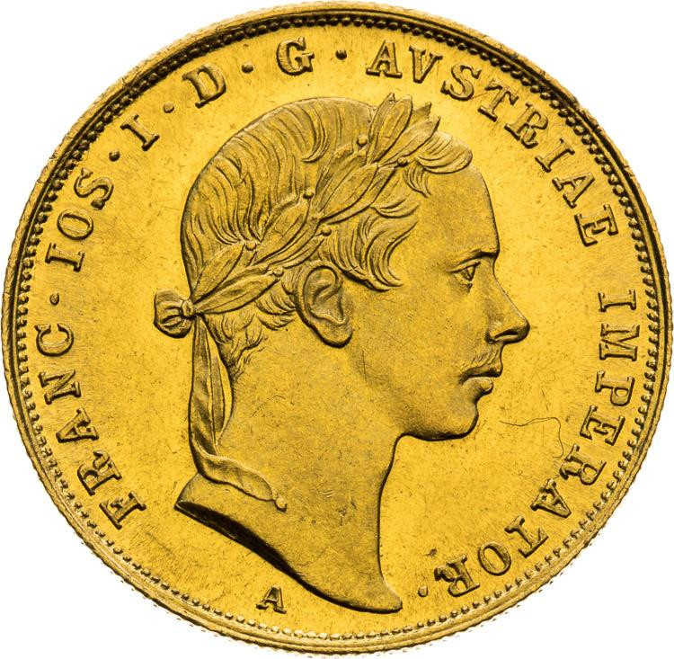
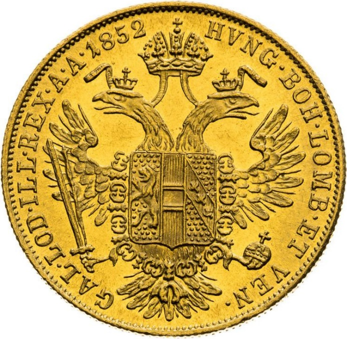

### 1858 📅 💰 1 Ducat („Galben”) 🌍 Austrian Empire

<!-- u:u00488 kind:quad -->

The local term "galben" (plural: "galbeni"), meaning "yellow," was used in the Danubian Principalities to refer to an expensive gold coin. While several gold coins were in circulation, it typically referred to the Austrian ducat, a high-value coin widely used in international trade and for larger transactions.
Figure 136: 1 Ducat 💰 Francis Joseph I 📅 1852 – 1859
