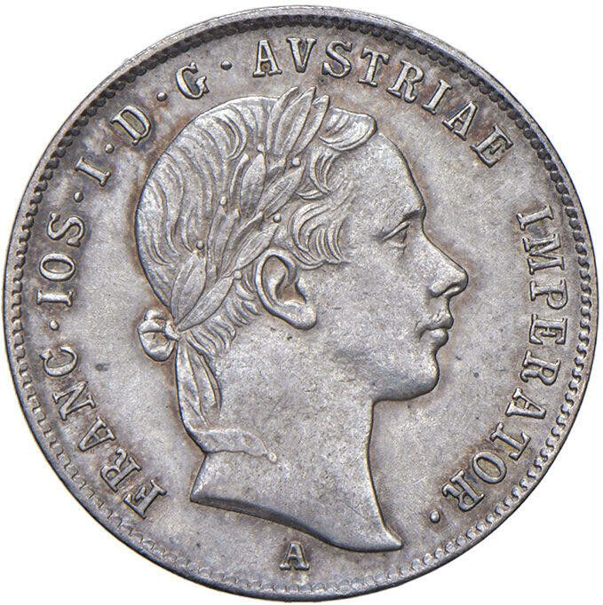
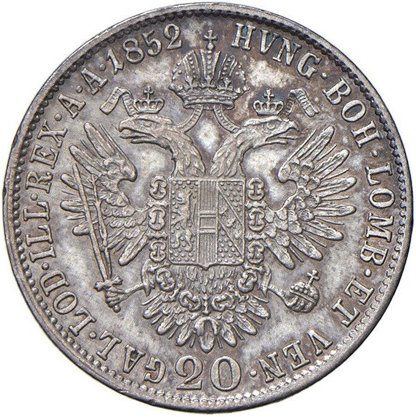

### 1858 📅 💰 20 Kreuzer / Zwanziger („Sfanţ”) 🌍 Austrian Empire

<!-- u:u00490 kind:quad -->

A silver coin originally from the Austrian Empire, the zwanziger (or "sfanţ" in local terms) was a popular medium of exchange in the Danubian Principalities. It had a relatively small value, 20 kreuzers, and was often used for everyday purchases.
Figure 137: 20 Kreuzers 💰 Francis Joseph I 📅 1852 – 1856
