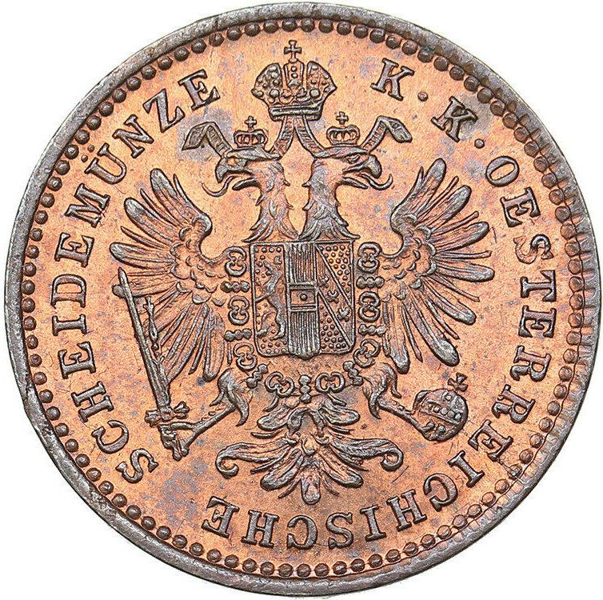
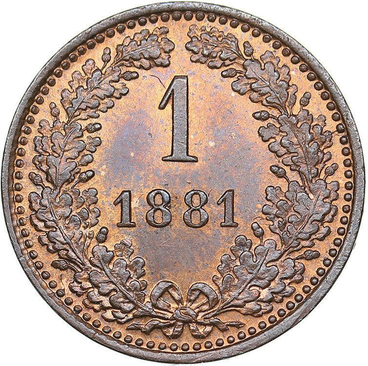

### 1858 📅 💰 1 Kreuzer („Creiţar”) 🌍 Austrian Empire

<!-- u:u00492 kind:quad -->

An Austrian currency unit, the kreuzer was widely used in European trade and was used in the principalities, especially in urban areas and regions with Austrian influence. It was a minor copper coin used in low-value exchanges.
Figure 138: 1 Kreuzer 💰 Francis Joseph I 📅 1858 – 1881
