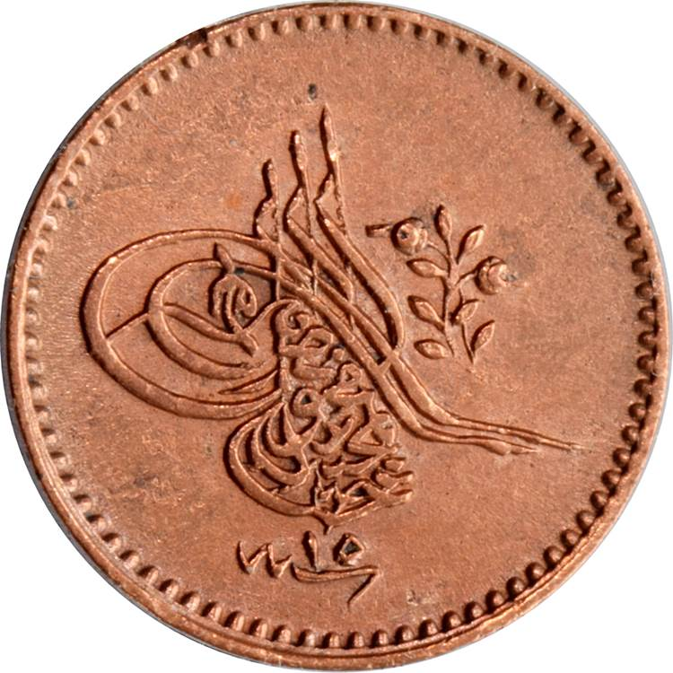
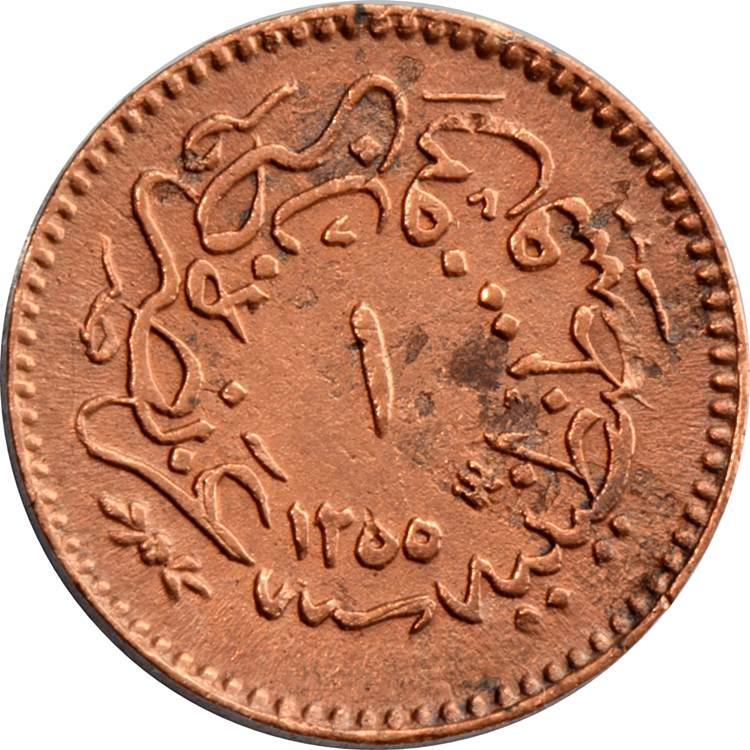

### 1858 📅 💰 1 Para 🌍 Ottoman Empire

<!-- u:u00499 kind:table -->

| The para, typically made of copper, was used for everyday transactions and small purchases, making it a common currency. Ottoman coins features a tughra, which is a calligraphic monogram or signature of the reigning sultan. | Paraua, fabricată de obicei din cupru, a fost utilizată pentru tranzacțiile zilnice și achizițiile mici, devenind astfel o monedă comună. Monedele otomane prezintă o tughra, care este o monogramă caligrafică sau semnătura sultanului. |  |  |
|---|---|---|---|
| Obverse | Reverse |  |  |
|  | Abdülmecid I tughra | عز نصره ضرب في قسطنطينية | May he be victorious / 🌍 Struck in Constantinople |
| ١٥ سنه | 15 Year An Année Jahr 📅 15th regnal year Al 15-lea an de domnie 15e année royale 15. Reichsjahr | ١ ١٢٥٥ سنه | 1 1255 AH Year An Année Jahr 📅 Start of reign Începutul domniei Début du règne Beginn der Regentschaft |
| Figure 139: 1 Para 💰 Abdülmecid I 📅 1846 – 1859 |  |  |  |
| Le para, généralement en cuivre, était utilisé pour les transactions quotidiennes et les petits achats, ce qui en faisait une monnaie courante. Les pièces ottomanes sont ornées d'un tughra, monogramme calligraphique ou signature du sultan régnant. | Der typischerweise aus Kupfer gefertigte Para wurde für alltägliche Transaktionen und kleine Einkäufe verwendet, was ihn zu einer gängigen Währung machte. Osmanische Münzen weisen eine Tughra auf, ein kalligrafisches Monogramm oder eine Unterschrift des herrschenden Sultans. |  |  |
