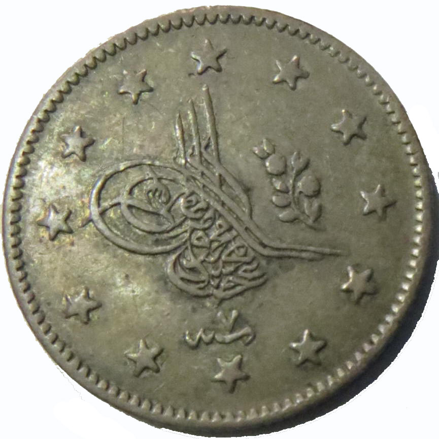
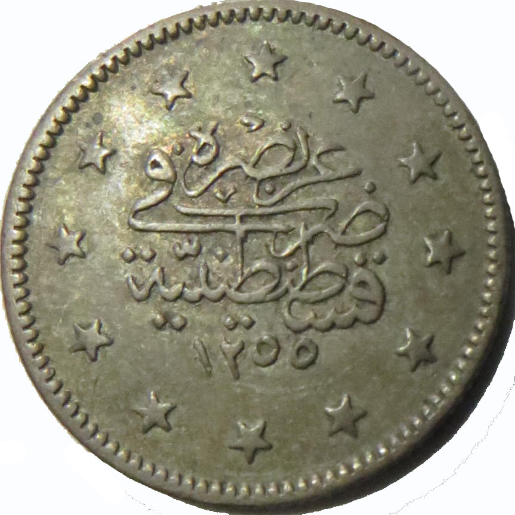

### 1858 📅 💰 1 Kurush / Piastre 🌍 Ottoman Empire

<!-- u:u00501 kind:table -->

| The kurush (also known as piastre in European languages) was a major currency unit in the Ottoman Empire, representing 40 paras. Widely used across the empire, including the Danubian Principalities, the kurush/piastre was a higher denomination coin compared to the para, and it was typically made of silver. | Kuruş (cunoscut și ca piastru în limbile europene) a fost o unitate monetară majoră în Imperiul Otoman, reprezentând 40 de parale. Utilizat pe scară largă în întregul imperiu, inclusiv în Principatele Dunărene, kuruş/piastru era o monedă cu valoare nominală mai mare decât paraua, şi era de obicei fabricat din argint. |  |  |
|---|---|---|---|
| Obverse | Reverse |  |  |
|  | Abdülmecid I tughra | عز نصره ضرب في قسطنطينية | May he be victorious / 🌍 Struck in Constantinople Fie ca el să fie victorios / 🌍 Bătut în Constantinopol Qu'il soit victorieux / 🌍 Gravé à Constantinople Möge er siegreich sein / 🌍 Gedruckt in Konstantinopel |
| ٧ سنه | 7 Year  📅 7th regnal year | ١ ١٢٥٥ سنه | 1 1255 AH Year  📅 Start of reign |
| Figure 140: 1 Kuruş / Piastre 💰 Abdülmecid I 📅 1844 – 1861 |  |  |  |
| Le kurush (également connu sous le nom de piastre dans les langues européennes) était une unité monétaire majeure dans l'Empire ottoman, représentant 40 paras. Largement utilisée dans tout l'empire, y compris dans les Principautés danubiennes, la kurush/piastre était une pièce de plus grande valeur nominale que le para, et elle était généralement en argent. | Die Kurusch (in den europäischen Sprachen auch als Piaster bekannt) war eine wichtige Währungseinheit im Osmanischen Reich und entsprach 40 Paras. Die Kurusch/Piaster war im gesamten Reich, auch in den Donaufürstentümern, weit verbreitet. Im Vergleich zum Para war die Kurusch/Piaster ein höherer Wert und bestand in der Regel aus Silber. |  |  |
