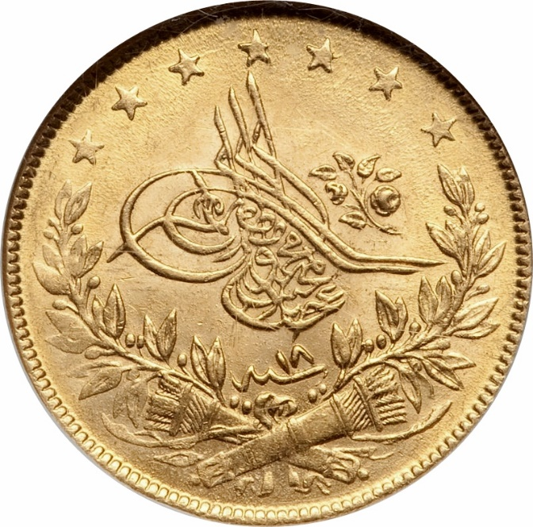
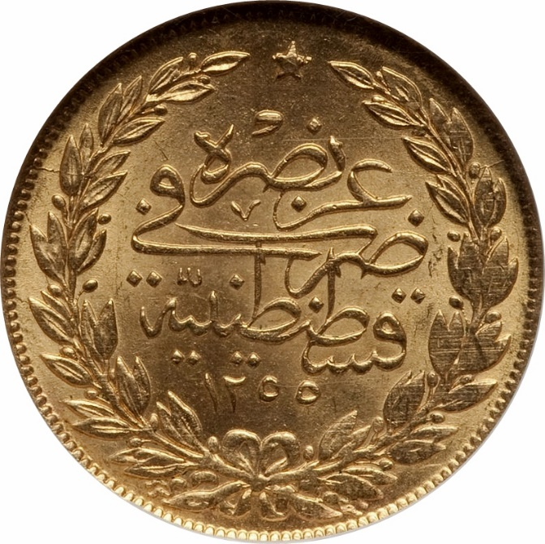

### 1858 📅 💰 100 Kurush / 1 Lira 🌍 Ottoman Empire

<!-- u:u00503 kind:table -->

| The Turkish lira was officially introduced as an accounting currency by the Ottoman Empire in 1844 during the currency reforms of Sultan Abdülmecid I. At that time, 1 lira was equivalent to 100 kurush (piastres). While the lira existed as a conceptual unit of account, actual coins used in daily transactions were kurush and para coins, which circulated in various denominations. | Lira turcească a fost introdusă oficial ca monedă pentru contabilitate de către Imperiul Otoman în 1844, în timpul reformelor monetare ale sultanului Abdülmecid I. La acea dată, 1 liră era echivalentă cu 100 de kuruş (piaştri). În timp ce lira exista ca unitate conceptuală de cont, monedele reale utilizate în tranzacțiile zilnice erau monedele kuruş și paraua, care circulau în diferite denominații. |  |  |
|---|---|---|---|
| Obverse | Reverse |  |  |
|  | Abdülmecid I tughra | عز نصره ضرب في قسطنطينية | May he be victorious / 🌍 Struck in Constantinople |
| ١٨ سنه | 18 Year  📅 18th regnal year | ١ ١٢٥٥ سنه | 1 1255 AH Year  📅 Start of reign |
| Figure 141: 100 Kurush 💰 Abdülmecid I 📅 1843 – 1861 |  |  |  |
| La lire turque a été officiellement introduite comme monnaie de compte par l'Empire ottoman en 1844, lors des réformes monétaires du sultan Abdülmecid I. À l'époque, 1 lire équivalait à 100 kurush (piastres). Alors que la lire existait en tant qu'unité de compte conceptuelle, les pièces utilisées dans les transactions quotidiennes étaient des pièces de kurush et de para, qui circulaient en différentes dénominations. | Die türkische Lira wurde 1844 im Zuge der Währungsreformen von Sultan Abdülmecid I. offiziell als Rechnungswährung eingeführt. 1 Lira entsprach damals 100 Kurusch (Piaster). Während die Lira als konzeptionelle Rechnungseinheit existierte, wurden die Kurusch- und Para-Münzen, die in verschiedenen Stückelungen im Umlauf waren, im täglichen Handel verwendet. |  |  |
