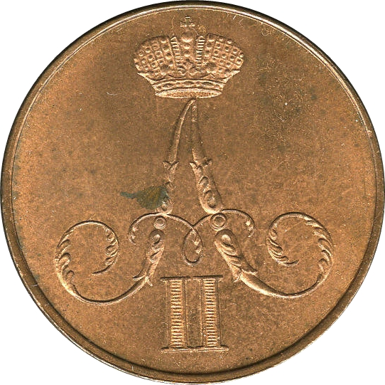
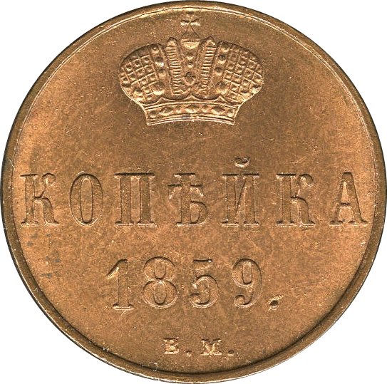

### 1858 📅 💰 1 Kopeck 🌍 Russian Empire

<!-- u:u00516 kind:quad -->

Peasants' reform of 1861
Alexander II is famous for freeing over 23 million serfs in 1861, an act that fundamentally changed Russian society. The Emancipation Reform was the first and most significant step towards modernizing Russia's agrarian economy, though it faced criticism for failing to provide adequate land and rights to the newly freed peasants.
Figure 142: 1 Kopeck 💰 Alexander II 📅 1855 – 1860
