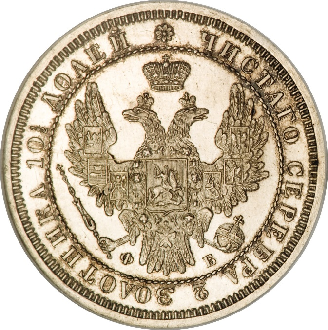
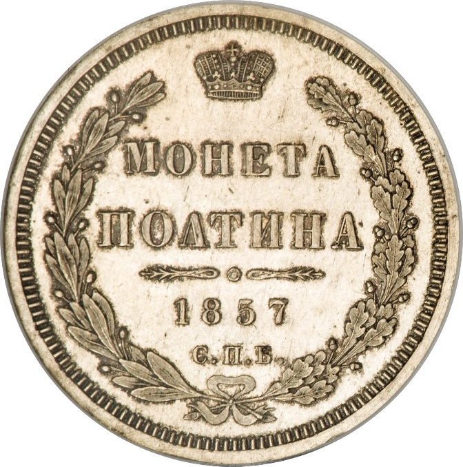

### 1858 📅 💰 1 Poltina 🌍 Russian Empire

<!-- u:u00518 kind:text -->
Nikolai I (1825-1855), Aleksandr II (1855-1881)

<!-- u:u00519 kind:quad -->

The Crimean War (1853-1856)
The Crimean War began during Nikolai I’s reign and became one of his most significant failures. Russia fought against an alliance of Britain, France, the Ottoman Empire, and Sardinia, and its defeat exposed the weaknesses of the Russian military and state. Nikolai did not live to see the war’s end, dying in 1855.
Figure 143: 1 Poltina 💰 Nikolai I / Aleksander II 📅 1832 – 1858
