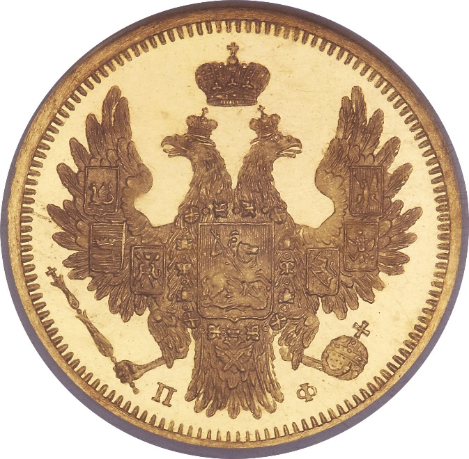
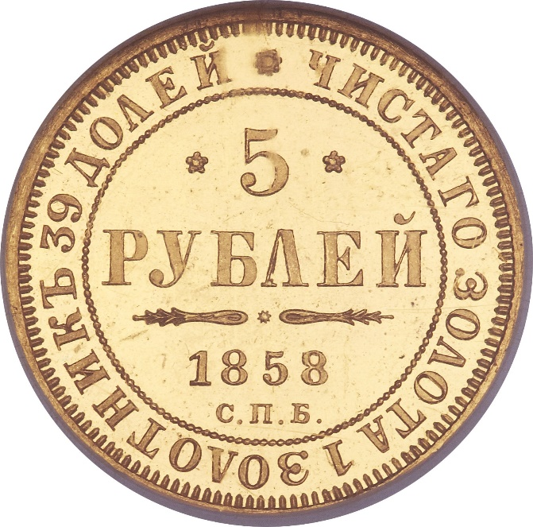

### 1858 📅 💰 5 Roubles 🌍 Russian Empire

<!-- u:u00521 kind:quad -->

Assassination of Alexander II (1881)
Alexander II of Russia faced numerous assassination attempts throughout his reign. In 1881, despite riding in a bulletproof carriage gifted by Napoleon III, he was fatally injured when revolutionaries attacked during a public appearance in St. Petersburg. The first bomb exploded near the carriage, and as the Tsar emerged unhurt to inspect the damage, a second bomb was thrown, killing him and several bystanders.
Figure 144: 5 Roubles 💰 Alexander II 📅 1855 – 1858
