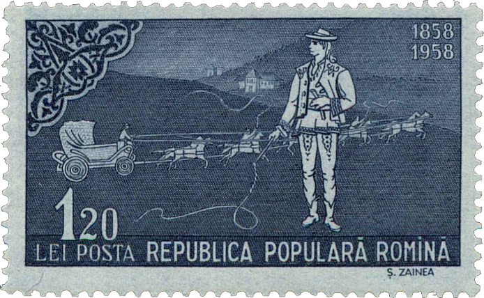

## 1858 📅 📯 Postal Reform 🌍 Iaşi (Jassy)

<!-- u:u00523 kind:text -->
1858-02-22    J📅G    1858-03-06

<!-- u:u00524 kind:quad -->

The Postal Reform
The Postal Reform is issued and will become effective from 1858-05-01.
The first Moldavian postage stamps were planned in accordance with the norms established by this reform.

PROJECT FOR THE REFORM OF POSTS, drawn up by the commission appointed by His Excellency the Prince Caïmacan and approved by the Administrative Council of Moldavia with application from May 1, 1858

M.F. #1760 from February 22 1858, A.S.B. fund D.P.D. file 1040/1858 f.37-68
