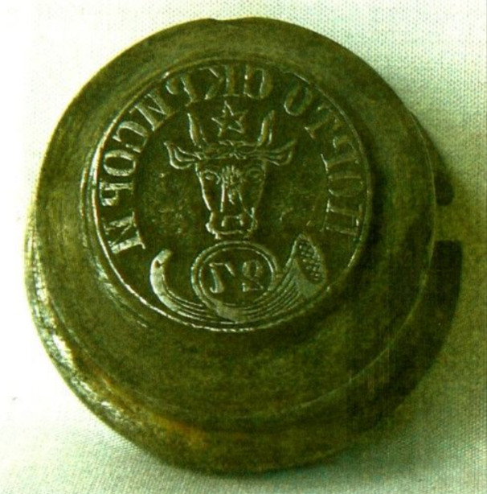
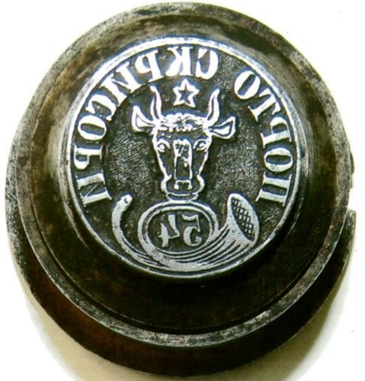
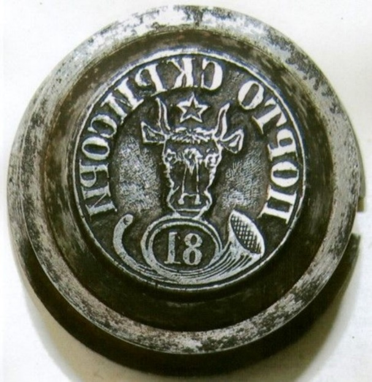
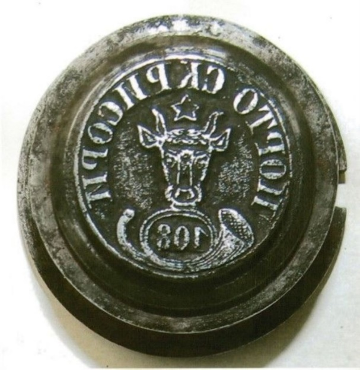

## 1858 📅 🐃 1: Metal Dies 🌍 Iaşi (Jassy)

<!-- u:u00535 kind:text -->
1858-07-01    J📅G    1858-07-13

<!-- u:u00536 kind:quad -->
Metal Dies
The Ministry of Finance (M.F., with address no. 5895) announces 'The Secretary of the Stamp Workshop’ (A.T.) that the four necessary types of dies have been created. 
These steel engraved dies are round, and have two openings for connecting to the printing device. The dies costed 389 lei.
The M.F. also announces that a total of 24,000 stamps are to be printed with these four types of dies, which are to be distributed "according to the established rates" as follows:

<!-- u:u00537 kind:quad -->
💰
Table 3: 1858 📅 🐃 1: Planned quantities
Cantităţi planificate | Quantités prévues | Geplante Mengen

<!-- u:u00539 kind:quad -->

Figure 147: 27 Parale: Metal die
