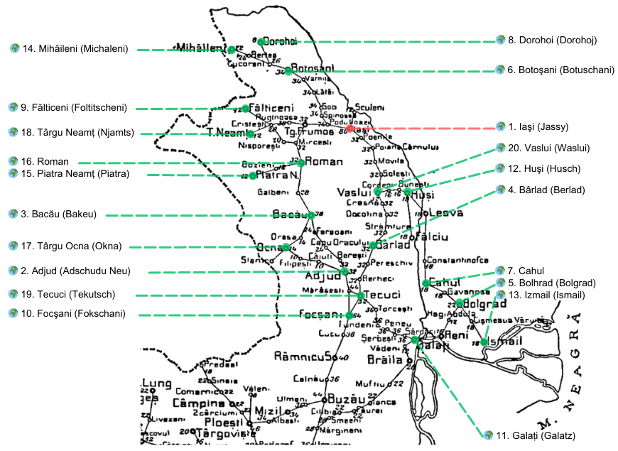

## 1858 📅 🐃 1: 🧭 Established rules for letters 🌍 Moldavia

<!-- u:u00541 kind:text -->
1858-07-01    J📅G    1858-07-13

<!-- u:u00542 kind:quad -->
Established Rules for Letters
Regarding the application of the new "distance and weight" tariff, the Postal Directorate of Moldavia published the "Established Rules for Letters" in instruction No. 1252 on July 1, 1858. A simple letter weighing up to 2.5 dramuri (8.07 grams or 0.28 ounces) cost 27 parale for distances up to 8 postal stations (first distance). For distances beyond 8 stations (second distance), the cost was 54 parale.
For example, sending a letter from Iași to nearby cities like Bacău, Botoșani, Dorohoi, and others, the cost was 27 parale. For destinations farther away, like Adjud, Bârlad, Bolgrad, and others, the cost increased to 54 parale. Letters sent within Iași also cost 27 parale.
For registered letters (with acknowledgment of receipt), postage was 81 parale for the first distance, and 108 parale for the second distance.
Some localities more than 8 post offices away were placed in distance 1 (e.g., Mihăileni, Tg. Ocna) relative to Iași. Also included in distance 1 are local transport shipments, found diagonally in the scheme. This is shown in the following table, which shows the distance factor (1 or 2) between localities.

<!-- u:u00543 kind:table -->

| Locations 🧭 Table 4 Figure 167, p.209 (10...18 ?) |
|---|

<!-- u:u00544 kind:table -->
| Table 4: 1858 📅 🐃 1: First and second distances |  |  |  |  |  |  |  |  |  |  |  |  |  |  |  |  |  |  |  |  |
|---|---|---|---|---|---|---|---|---|---|---|---|---|---|---|---|---|---|---|---|---|
| 🌍 | 1 | 2 | 3 | 4 | 5 | 6 | 7 | 8 | 9 | 10 | 11 | 12 | 13 | 14 | 15 | 16 | 17 | 18 | 19 | 20 |
| 1 | 1 | 2 | 1 | 2 | 2 | 1 | 2 | 1 | 1 | 2 | 2 | 1 | 2 | 1 | 1 | 1 | 1 | 1 | 2 | 1 |
| 2 | 2 | 1 | 1 | 2 | 2 | 2 | 2 | 2 | 2 | 1 | 1 | 2 | 2 | 2 | 1 | 1 | 1 | 2 | 1 | 2 |
| 3 | 1 | 1 | 1 | 2 | 2 | 2 | 2 | 2 | 1 | 1 | 2 | 2 | 2 | 2 | 1 | 1 | 1 | 1 | 1 | 2 |
| 4 | 2 | 2 | 2 | 1 | 2 | 2 | 2 | 2 | 2 | 1 | 1 | 1 | 2 | 2 | 2 | 2 | 2 | 2 | 1 | 1 |
| 5 | 2 | 2 | 2 | 2 | 1 | 2 | 1 | 2 | 2 | 2 | 1 | 1 | 1 | 2 | 2 | 2 | 2 | 2 | 2 | 1 |
| 6 | 1 | 2 | 2 | 2 | 2 | 1 | 2 | 1 | 2 | 2 | 2 | 2 | 2 | 1 | 2 | 2 | 2 | 2 | 2 | 2 |
| 7 | 2 | 2 | 2 | 2 | 1 | 2 | 1 | 2 | 2 | 2 | 1 | 1 | 1 | 2 | 2 | 2 | 2 | 2 | 2 | 1 |
| 8 | 1 | 2 | 2 | 2 | 2 | 1 | 2 | 1 | 2 | 2 | 2 | 2 | 2 | 1 | 2 | 2 | 2 | 2 | 2 | 2 |
| 9 | 1 | 2 | 1 | 1 | 2 | 2 | 2 | 2 | 1 | 2 | 2 | 2 | 2 | 2 | 1 | 1 | 2 | 1 | 2 | 2 |
| 10 | 2 | 1 | 1 | 2 | 2 | 2 | 2 | 2 | 2 | 1 | 1 | 2 | 2 | 2 | 2 | 1 | 1 | ...? | 1 | 1 |
| 11 | 2 | 1 | 2 | 1 | 1 | 2 | 1 | 2 | 2 | 1 | 1 | 1 | 1 | 2 | 2 | 2 | 2 | 2 | 1 | 2 |
| 12 | 1 | 2 | 2 | 1 | 1 | 2 | 1 | 2 | 2 | 2 | 1 | 1 | 1 | 2 | 2 | 2 | 2 | 2 | 2 | 1 |
| 13 | 2 | 2 | 2 | 2 | 1 | 2 | 1 | 2 | 2 | 2 | 1 | 1 | 1 | 2 | 2 | 2 | 2 | 2 | 2 | 2 |
| 14 | 1 | 2 | 2 | 2 | 2 | 1 | 2 | 1 | 2 | 2 | 2 | 2 | 2 | 1 | 2 | 2 | 2 | 2 | 2 | 2 |
| 15 | 1 | 1 | 1 | 2 | 2 | 2 | 2 | 2 | 1 | 2 | 2 | 2 | 2 | 2 | 1 | 1 | 1 | 1 | 2 | 2 |
| 16 | 1 | 1 | 1 | 2 | 2 | 2 | 2 | 2 | 1 | 1 | 2 | 2 | 2 | 2 | 1 | 1 | 1 | 1 | 2 | 2 |
| 17 | 1 | 1 | 1 | 2 | 2 | 2 | 2 | 2 | 2 | 1 | 2 | 2 | 2 | 2 | 1 | 1 | 1 | 2 | 1 | 2 |
| 18 | 1 | 2 | 1 | 2 | 2 | 2 | 2 | 2 | 1 | 2 | 2 | 2 | 2 | 2 | 1 | 1 | 2 | 1 | 2 | 2 |
| 19 | 2 | 1 | 1 | 1 | 2 | 2 | 2 | 2 | 2 | 1 | 1 | 2 | 2 | 2 | 2 | 2 | 1 | 2 | 1 | 1 |
| 20 | 1 | 2 | 2 | 1 | 1 | 2 | 1 | 2 | 2 | 1 | 2 | 1 | 2 | 2 | 2 | 2 | 2 | 2 | 1 | 1 |
