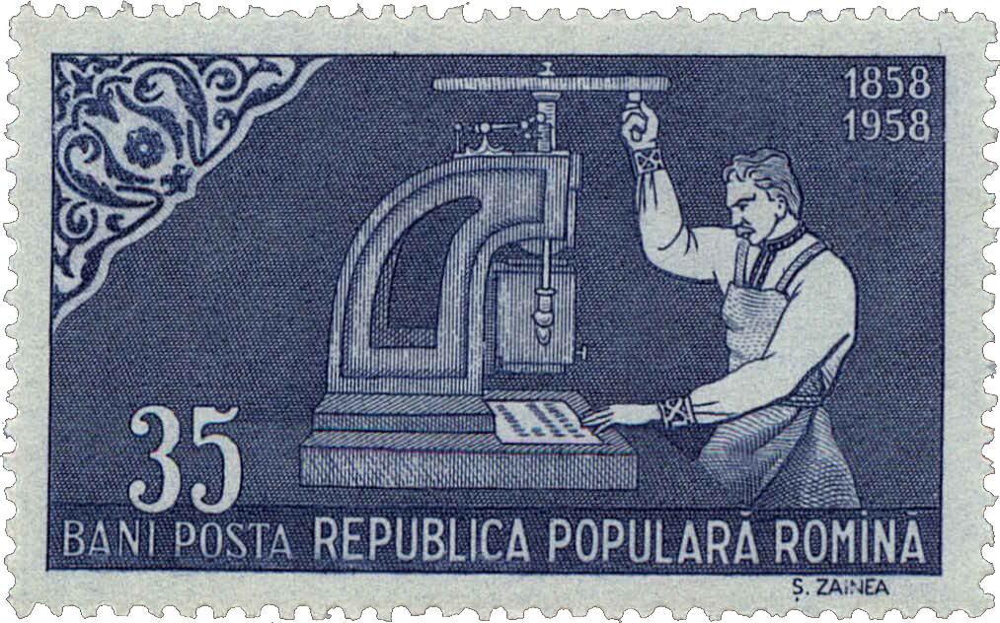
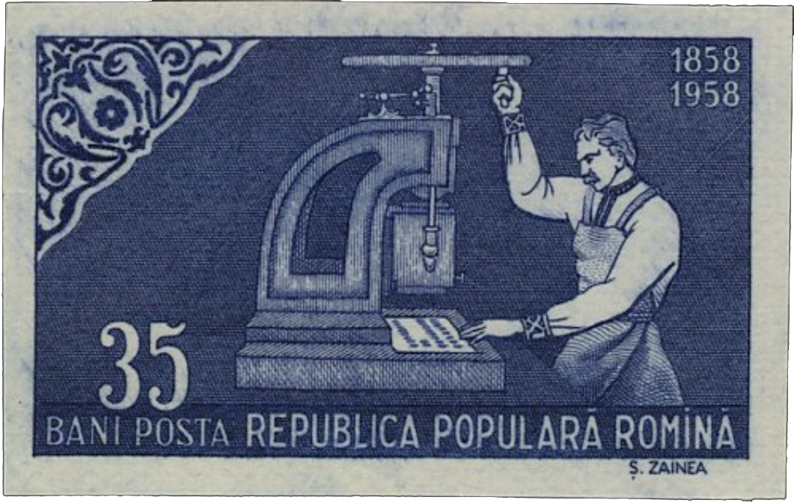
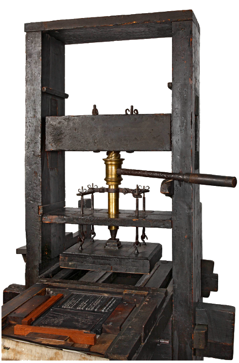
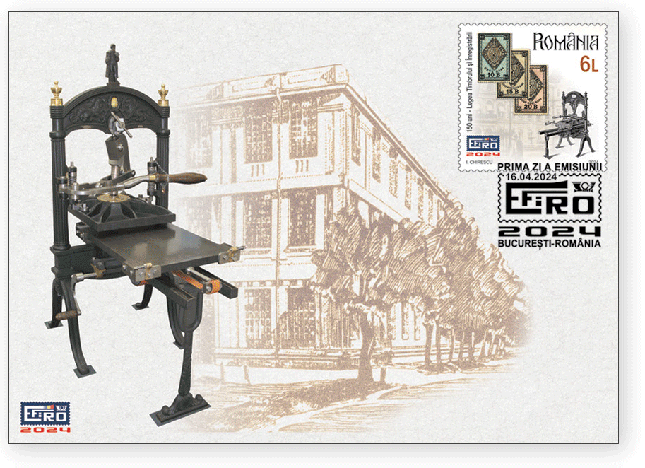
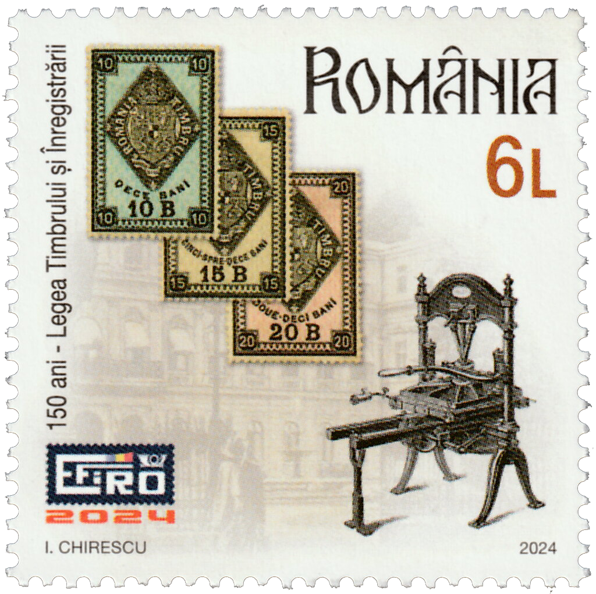
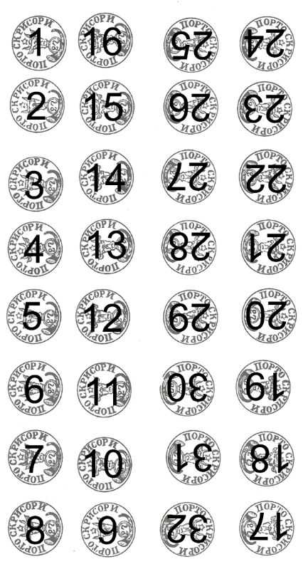
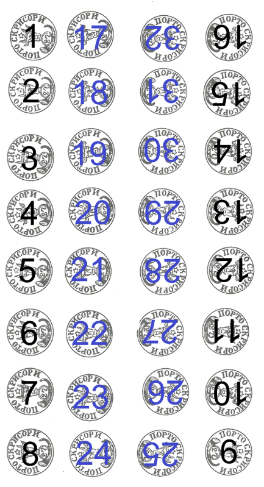
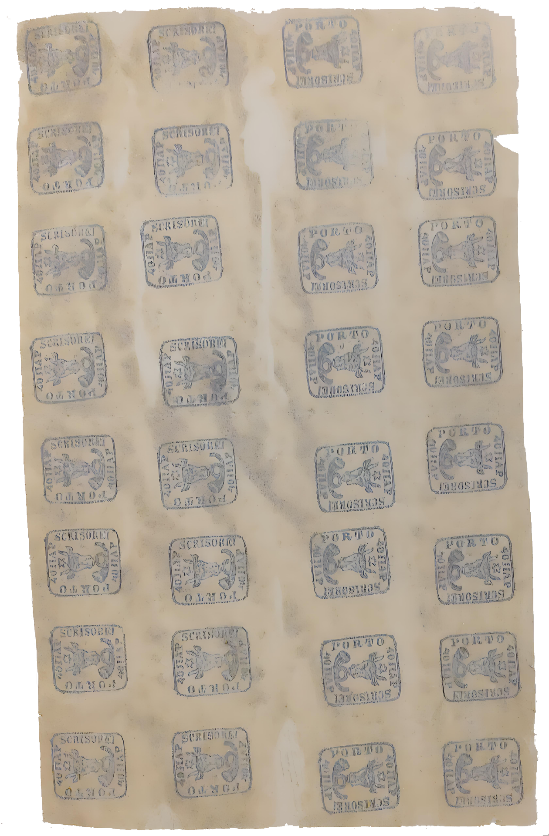
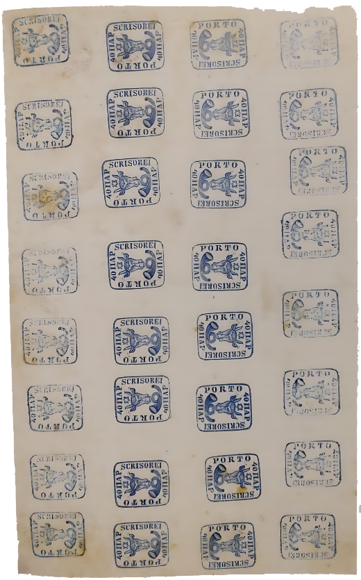

## 1858 📅 🐃 1: Printing process 🌍 Iaşi (Jassy)

<!-- u:u00546 kind:quad -->
Printing process
The exact name of the press model used does not appear in the available historical documents, which describe functionality rather than form.
Since a new printing press was acquired in 1857, the Stamp Workshop had at least one more older press in its possession.
In the centennial 📖 MI RO 1750, is one of the few illustrations of such a press. 
The press had a rotating mechanism for vertically pressing a metal die onto a sheet of paper. 
The metal die was screwed to a support called a 'printing plate' which rested on a vertical axis on top of the paper sheet lying on a work table.
Due to the high costs of the engraving process and the shared fine details among the stamps, it is highly likely that the first two stamp issues in Moldavia were produced using the same set of metal dies. Therefore, to verify a stamp's authenticity, one should closely inspect the specific design details imprinted by the metal die.
The press worked on the same basic principle as the one in Figure 153, which is more than a century older, dating from 1700-1750.
One of the best representations of the printing press is provided on a stamp (Figure 154) commemorating 150 years since the 1874 fiscal stamps were issued.

<!-- u:u00547 kind:figure -->

*Figure 151: 📖 MI RO 1750A*

<!-- u:u00550 kind:figure -->

*Figure 152: 📖 MI RO 1750B*

<!-- u:u00552 kind:figure -->

*Figure 153: Wooden printing press 📅 First half of the 18th century*

<!-- u:u00554 kind:figure -->

<!-- u:u00555 kind:text -->
✉ FDC ⬆

<!-- u:u00556 kind:figure -->

*Figure 154: EFIRO 2024*

<!-- u:u00558 kind:text -->
Manual print

<!-- u:u00559 kind:text -->
The printing of the first "Cap de Bour" stamps in Moldova took place at the "Atelierul Timbrului", which had already been printing the "Timbrul Domnesc" for two years.

<!-- u:u00560 kind:text -->
The workshop used a small printing press with a limited working area, capable of holding one sheet of paper at a time. This press was equipped with a mechanism that allowed a plate (to which the metal die was attached) to be lowered onto the paper, thus printing.

<!-- u:u00561 kind:text -->
As the same press was still needed for printing the 'Domnesc Stamp', no modifications to the machine were allowed. Thus, the existing press set-up was also used to print the new "Cap de Bour" stamps, using the same technique previously used to print a single "wet" stamp in the corner of the page.

<!-- u:u00562 kind:text -->
⏭ The manual printing process described is documented in 📖 Wertheimer-Ghika, 1944.

<!-- u:u00563 kind:text -->
The metal die with the "Cap de Bour" stamp design was mounted on the printing plate, and a sheet of paper was placed on the small press table. The operator manually lowered the printing plate until the die touched the paper. This transferred the ink design from the metal stencil to the paper, creating a 'wet' stamp. The first stamp was affixed to the corner of the sheet of paper, in the same way as for the the "Timbrul Domnesc".

<!-- u:u00564 kind:text -->
The press was then raised, lifting the metal die off the paper. After printing the first stamp in the corner, the operator would push the sheet of paper slightly forward, aligning it for the next stamp in the column, while the metal die remained fixed in the same place on the plate.

<!-- u:u00565 kind:text -->
However, the manual process presented a significant challenge: once the plate was lowered, the operator's visibility was obstructed, making it difficult to accurately align subsequent stamps. As a result, some stamps were accidentally printed too close together and sometimes even overlapped.

<!-- u:u00566 kind:text -->
The plate was lowered again to print the next stamp in the column. This process was repeated for each of the 8 stamps in the column, one at a time. After printing all 8 stamps in the first column, the sheet of paper was moved slightly to the edge of the table to align the next column under the die fixed to the printing plate.

<!-- u:u00567 kind:text -->
This process continued for another 8 stamps, printing the second column adjacent to the first. At the end of this step, the sheet of paper had two adjacent columns, each containing 8 stamps printed in the same orientation.

<!-- u:u00568 kind:text -->
After the second column was completed, there was not enough room on the small press table to move the paper sideways for additional columns. The table size and paper width limited further horizontal movement. To print a third column, the sheet of paper had to be turned upside down.

<!-- u:u00569 kind:text -->
This maneuver allowed an additional column to be printed on the opposite edge of those already printed.After printing the third column, with the paper inverted, the last column of stamps was printed in a reverse orientation (tête-bêche). The top of each stamp in the fourth column faced the bottom of the stamps in the second column.

<!-- u:u00570 kind:text -->
This tête-bêche arrangement of the center columns was a direct result of the limitations of the printing equipment, which did not allow a continuous flow for multiple columns without turning the sheet over. The process was repeated until all 4 columns were printed, resulting in a pair of middle columns printed in tête-bêche format.

<!-- u:u00571 kind:text -->
In the author’s opinion, complementing Wertheimer-Ghika’s observations, the fact that the printing was carried out by two employees – one experienced and one novice – suggests that the senior printer might have asked the junior to start with the outer columns of the sheet, which were probably easier to execute. On some surviving sheets, the first and fourth columns (the outer ones) display a different shade of colour, indicating that they may have been printed at different times.

<!-- u:u00572 kind:text -->
The sequence in which the stamps were printed is illustrated in the following figure.

<!-- u:u00589 kind:text -->
Impression manuelle

<!-- u:u00605 kind:text -->
Handgedruckte

<!-- u:u00621 kind:quad -->

Print sequence – variant 1 (?)
⏭ Figure 190
🐃 1
