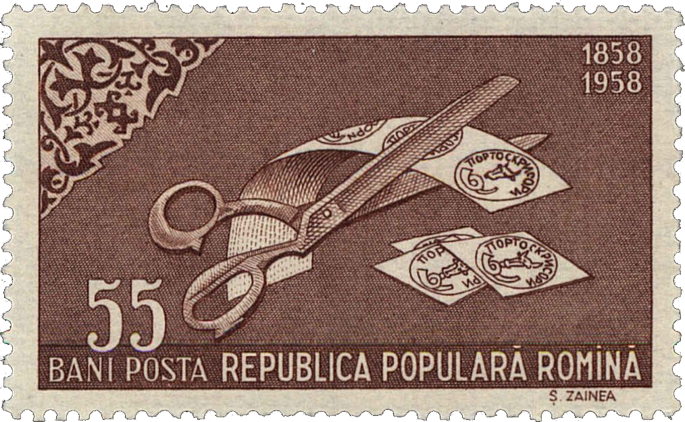

## 1858 📅 🐃 1: Putting into circulation 🌍 Iaşi (Jassy)

<!-- u:u00646 kind:text -->
1858-07-22    J📅G    1858-08-03

<!-- u:u00647 kind:quad -->

Putting into circulation
Although July 15, 1858 (J), was the planned issue date, the stamps were first circulated at the Central Office in Iasi a week later. According to the register titled "Protocol of Received Letters, Simple and Packages, as well as Newspapers Received and Sent During 1858" (A.S.B. dos. 6997/1858), the first 16 simple letters and 7 registered ones ("Recepisse") numbered 992–998, were stamped on Tuesday, July 22, 1858 (J). Other offices followed on August 4 (J), except (September 1st, J) for Galati and Tg. Neamt (without a handstamp).
On August 1, 1858, stamps were also put on sale in the shops of Gheorghe Hristofor and Joan Daniil Maughsch, where stamped paper was also sold.
Figure 156: 📖 MI RO 1751A
