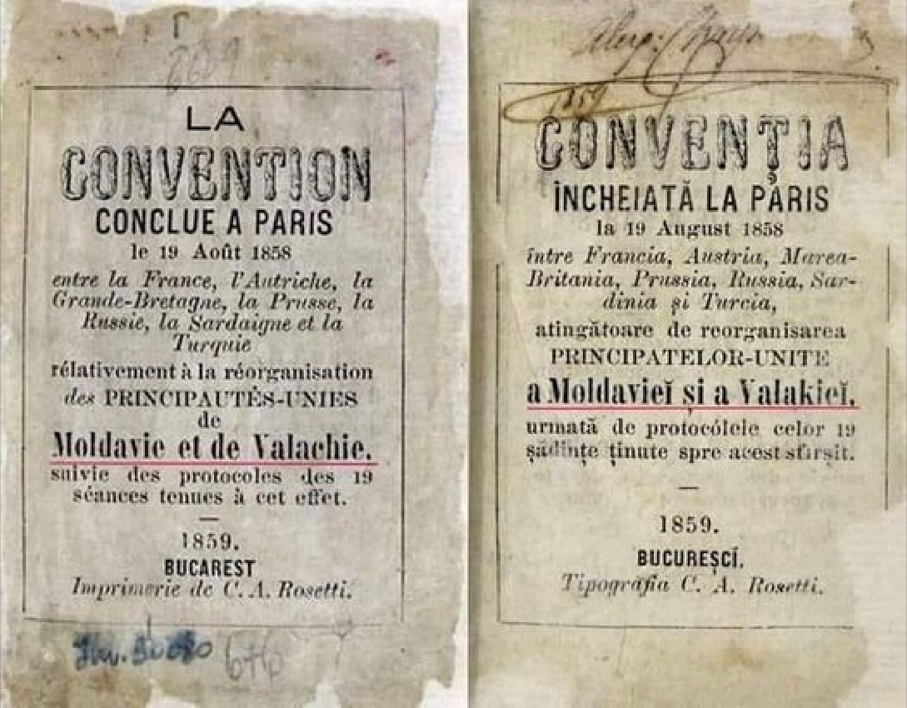

## 1858 📅 Convention 🌍 Paris

<!-- u:u00649 kind:text -->
1858-08-07    J📅G    1858-08-19

<!-- u:u00650 kind:quad -->

The Paris Convention
"Convention for the definitive organization of the Danubian Principalities of Moldavia and Wallachia"
The Paris Convention sets the terms for the unification of the principalities.
Article 1 established that the Principalities of Moldavia and Wallachia would henceforth be united under the name "United Principalities of Moldavia and Wallachia," remaining under the suzerainty of the Ottoman Sultan. 
Article 8 stipulated that the Principalities were to pay an annual tribute to the suzerain court, fixed at 1.500.000 Piastres (Lei) for Moldavia and 2.500.000 Piastres (Lei) for Wallachia.
Figure 157: The Paris Convention
