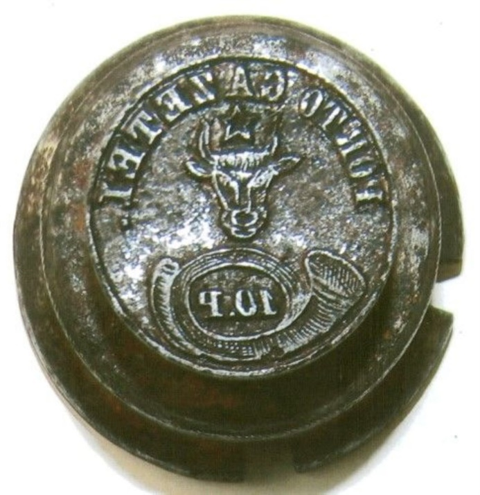

## 1858 📅 📯 10 Parale 📰 Newspaper stamp 🌍 Iaşi (Jassy)

<!-- u:u00656 kind:text -->
1858-09-12    J📅G    1858-09-24

<!-- u:u00657 kind:quad -->

10 Parale 📰 Newspaper stamp
The Moldavian Post (D.P.D.) issues a request (no. 2227) to the Ministry of Finance (M.F.) for the use of a 10-parale metal die for the newspaper stamps. The metal die was created, but no stamps were printed, because the cost of mailing newspapers will soon be reduced to 5 parale. At the top we see the text "porto gazetei", written in Romanian using Latin letters, framing the central image.
