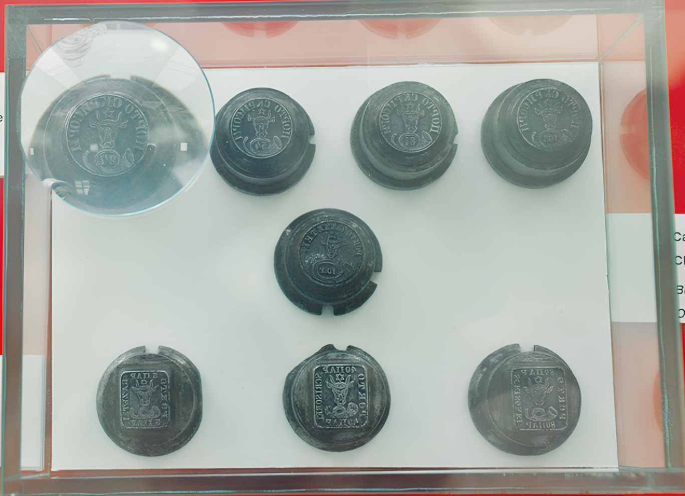

## 1858 📅 🐃 2: A.T. requests metal dies from M.F. 🌍 Iaşi (Jassy)

<!-- u:u00665 kind:text -->
1858-10-18    J📅G    1858-10-30

<!-- u:u00666 kind:quad -->
Metal dies
The Stamp Workshop, on October 18 (J), requests the metal dies from the Ministry of Finance.

<!-- u:u00667 kind:figure -->

*Figure 160: 1858 📅 🐃 1 & 2: Metal dies*
