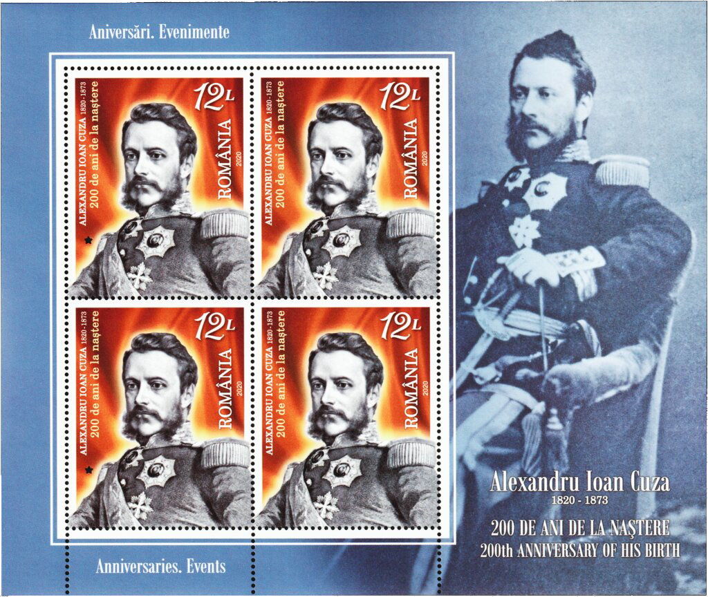
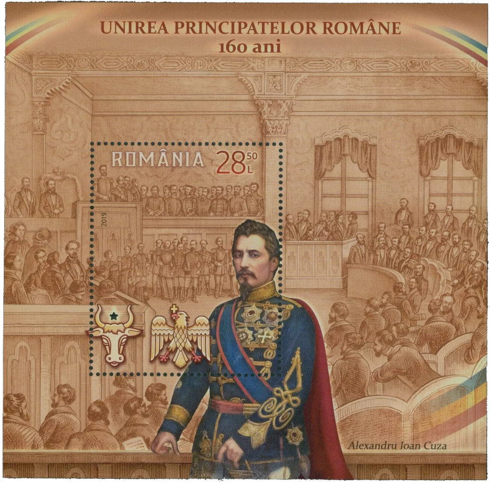
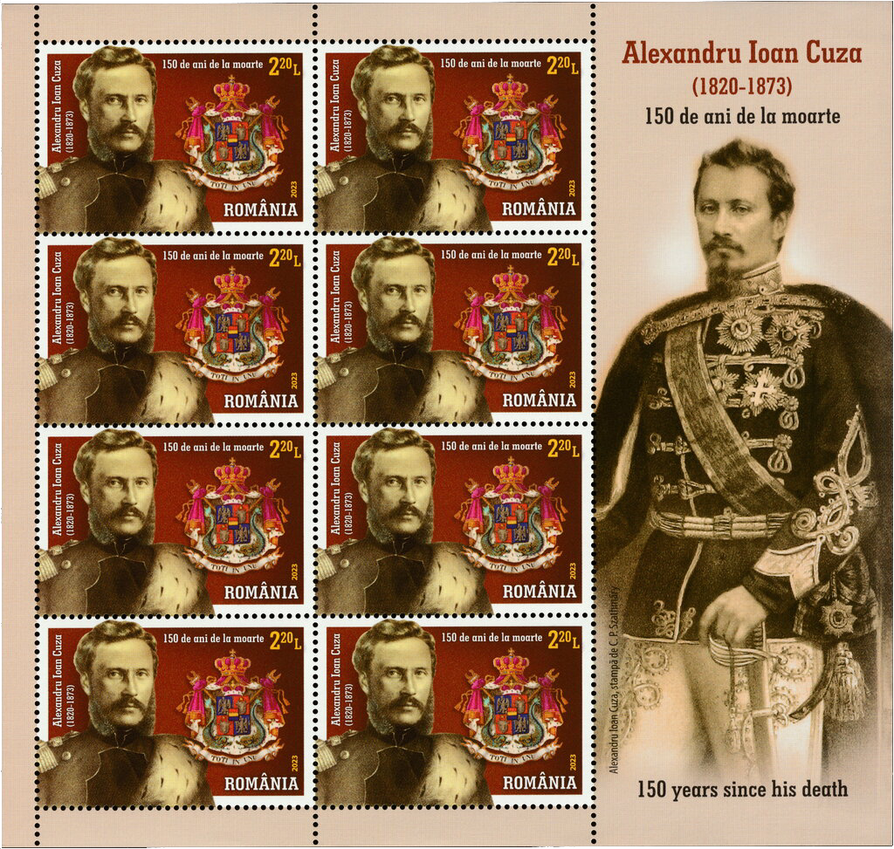
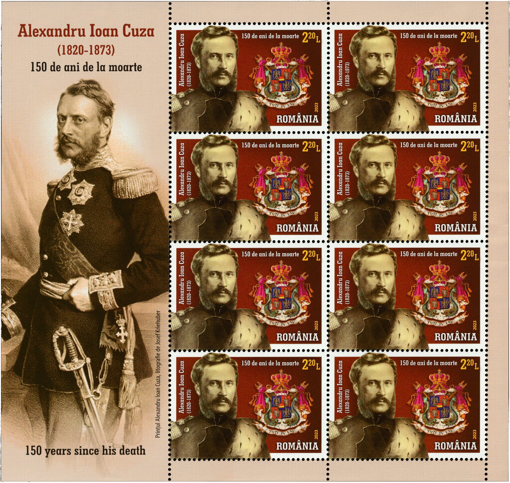

## 1859 📅 Alexandru Ioan Cuza 🌍 Iaşi (Jassy)

<!-- u:u00690 kind:text -->
1859-01-05    J📅G    1859-01-15

<!-- u:u00691 kind:quad -->
Cuza's election in Moldavia
Grigore Sturdza had mobilized about 1,200 Polish mercenaries in support of his plan, and by January 5, 450 of them had already been strategically placed in Iasi. This paramilitary force was to ensure, through intimidation or violence, Sturdza's election as ruler of Moldavia. The plan was for these mercenaries to block any protests against Sturdza and to physically eliminate Unionist leaders if necessary.
On the night of January 3, 1859, the Unionist leaders decided to nominate Alexandru Ioan Cuza, commander of the Moldovan army, as ruler of Moldavia.
On January 5, Grigore Sturdza infiltrated Polish agents into the polling room to prevent possible protests in the event of his election. However, his candidacy was rejected by the authorities, and Alexandru Ioan Cuza, warned of the danger, mobilized troops around the building to ensure order. Sturdza's plan failed, but tensions remained extremely high as foreign powers, especially France, awaited approval. In the meantime, Sturdza's mercenaries, now out of control, gathered at the Baba-Rada Inn, where they decided to assassinate the Unionist leaders, including Mihail Kogălniceanu, considered a traitor. Sturdza set January 13 as the date for a coup d'état.
Sturdza's plots were revealed in large part due to internal treachery in his camp. Alecu von Onciul and Iacob Antosz, close to Sturdza's group, informed the Unionist party of Sturdza's intentions, including plans to occupy Iasi, mobilize mercenaries and assassinate Unionist leaders. On the basis of this information, troops loyal to Cuza were deployed at key points in the city, ensuring the protection of the deputies and leaders of the Unionist party. The authorities foiled the planned coup and Sturdza's mercenaries were disarmed.
Firm action by the authorities culminated in the arrest of the leaders of the plot and the seizure of weapons hidden in a forest near Iasi. Sturdza's forces were neutralized and his political influence significantly reduced. The disclosures and the measures taken strengthened the position of the Unionists, thus facilitating the union process. The election of Alexandru Ioan Cuza as ruler of Moldavia was the first concrete step towards realizing the dream of unification, despite internal and external opposition that threatened to undermine this national ideal.

<!-- u:u00692 kind:figure -->

*Figure 161: 📖 MI RO 7688AKB*

<!-- u:u00694 kind:figure -->

*Figure 162: 📖 MI RO Block 777*

<!-- u:u00697 kind:figure -->

*Figure 163: 📖 MI RO 8187KBII*

<!-- u:u00699 kind:figure -->

*Figure 164: 📖 MI RO 8187KBI*
