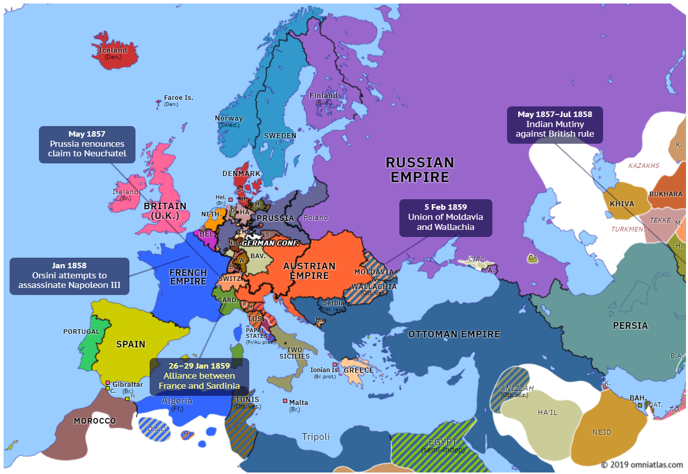
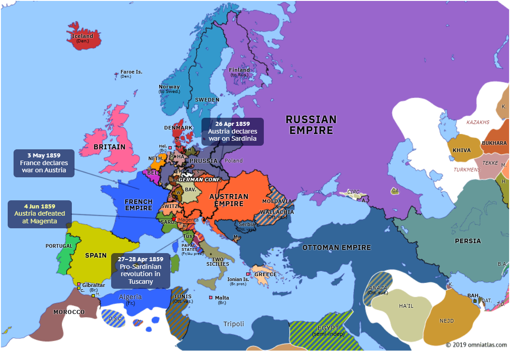

## 1859 📅 🧭 Alexandru Ioan Cuza 🌍 Bucureşti

<!-- u:u00702 kind:text -->
1859-01-24    J📅G    1859-02-05

<!-- u:u00703 kind:quad -->
Cuza's election in Wallachia
Elections for the elective Assembly of Wallachia were held between January 8/20 and 12/24, 1859, and the conservatives won 46 of the 72 seats. The Assembly officially opened on January 22/February 3 in a tense atmosphere. On the night of January 23-24, National Party leaders and Conservative MPs met at the Hotel Concordia in Bucharest to find a solution to the political impasse. Dimitrie Gr. Ghica, the solution of double elections was accepted as the only viable way forward.
On January 24/February 5, 1859, in a secret session chaired by the lawyer Vasile Boerescu, the deputies advocated the principle of Union, invoking respect for "the spirit of the Paris Convention". Alexandru Ioan Cuza was proposed and voted in as ruler of Wallachia, with the support of 64 deputies.
Cuza's double election as ruler of both principalities brought about the de facto union of Moldavia and Wallachia. This political act respected the Paris Convention and was an essential step in the formation of the modern Romanian state. Alexandru Ioan Cuza was enthusiastically welcomed in Bucharest on February 8/20, 1859.

<!-- u:u00704 kind:quad -->
Reaction of the major powers
The election of Alexandru Ioan Cuza as ruler of the United Principalities was officially recognized on 1/13 April 1859 at the Paris Conference, where the guarantor Powers validated his double election. Austria recognized this fact on 2/14 May 1859 in an official note, which strengthened relations with the governments of Iași and Bucharest.
Subsequently, on 22 November/4 December 1861, the Ottoman Porte issued the "Firmanul de organizare amministrativa a Moldovei și Valahiei" (Sign of the administrative organization of Moldavia and Wallachia), which admitted the administrative and political union of the two principalities. Among the measures adopted were the merger of the ministries of Iași and Bucharest into a single government, the unification of the elective assemblies, the suspension of the Central Commission in Focșani and the establishment of a provincial council in each principality, responsible for consultation on local laws and regulations.

<!-- u:u00705 kind:text -->
📖 Euronews 📅 2024

<!-- u:u00706 kind:figure -->

*Figure 165: 🧭 Europe 🌍 Events before the union 📅 1857 – 1859*

<!-- u:u00708 kind:figure -->

*Figure 166: 🧭 Europe 🌍 Events shortly after the union 📅 1859*
