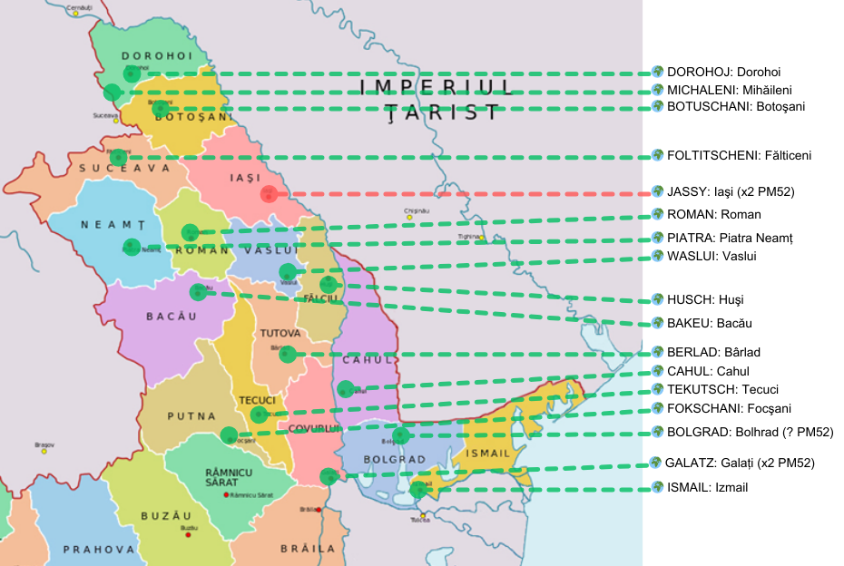

## ⨀ PM52 🧭 Post offices 🌍 Moldavia 📅 1856

<!-- u:u00735 kind:quad -->
⨀ PM52 – Post offices
In 1856, three additional post offices were established in Bolgrad, Cahul, and Ismail. The Moldova Post (D. Cantacuzino) ordered a "franco" PM52 hand stamp for each of these offices. These places are located in present-day Moldova and Ukraine. The other 14 offices that also had the PM52 hand stamp are situated in present-day Romania. Galați and Iași had two types of PM52 designs, but the type used in Bolgrad remains unknown.

<!-- u:u00736 kind:table -->

| ⨀ PM52 🧭 Post offices 🌍 Moldova 📅 1856 Figure 111, p.134 |
|---|

<!-- u:u00737 kind:table -->
| ⨀ PM52 – Bureaux de poste En 1856, trois bureaux de poste supplémentaires sont créés à Bolgrad, Cahul et Ismail. La Poste de Moldavie (D. Cantacuzino) a commandé un cachet à main PM52 "franco" pour chacun de ces bureaux. Ces lieux sont situés dans les actuelles Moldavie et Ukraine. Les 14 autres bureaux qui ont également reçu le cachet PM52 sont situés dans l'actuelle Roumanie. Galați et Iași disposaient de deux types de PM52, mais le type utilisé à Bolgrad reste inconnu. | ⨀ PM52 – Postämter Im Jahr 1856 wurden drei weitere Postämter in Bolgrad, Cahul und Ismail eingerichtet. Die moldauische Post (D. Cantacuzino) bestellte für jedes dieser Ämter einen "franco" PM52-Handstempel. Diese Orte befinden sich in der heutigen Republik Moldau und der Ukraine. Die anderen 14 Ämter, die ebenfalls den PM52-Handstempel erhielten, liegen im heutigen Rumänien. Galați und Iași verfügten über zwei Typen von PM52-Konstruktionen, der in Bolgrad verwendete Typ ist jedoch unbekannt. |
|---|---|
