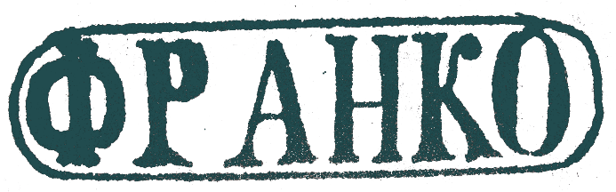
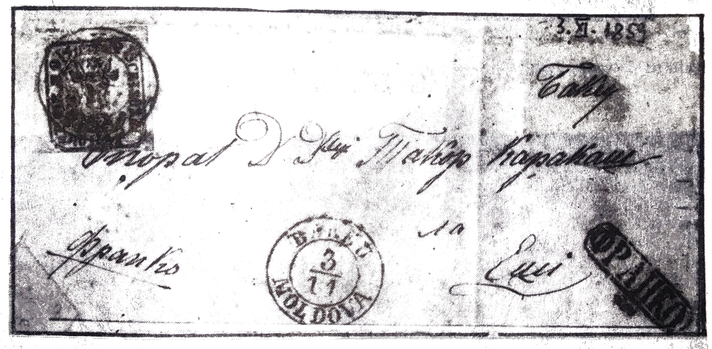

## ⨀ PM52 🌍 Bacău (Bakeu)

<!-- u:u00739 kind:table -->

| 🎨 Black \| Negru \| Noir \| Schwarz | 🎨 Dark greenish blue \| Albastru verzui închis \| Bleu verdâtre foncé \| Dunkles grünliches Blau |
|---|---|

<!-- u:u00740 kind:figure -->

*Figure 168: 1859-11-03 J 📅 ✉ 40 Parale ⨀ PM52 🌍 Bacău (Bakeu)*
