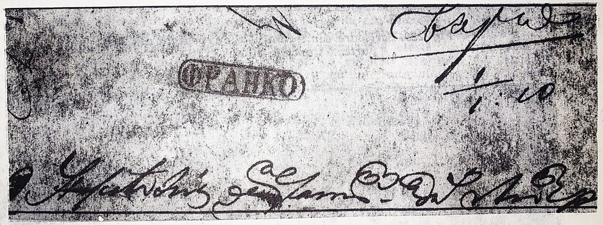

## ⨀ PM52 🌍 Bârlad (Berlad)

<!-- u:u00743 kind:table -->

| 🎨 Black \| Negru \| Noir \| Schwarz | 🎨 Dark greenish blue \| Albastru verzui închis \| Bleu verdâtre foncé \| Dunkles grünliches Blau |
|---|---|

<!-- u:u00744 kind:figure -->

*Figure 169: 1859-10-01 J 📅 ✉ ⨀ PM52 🌍 Bârlad (Berlad)*
