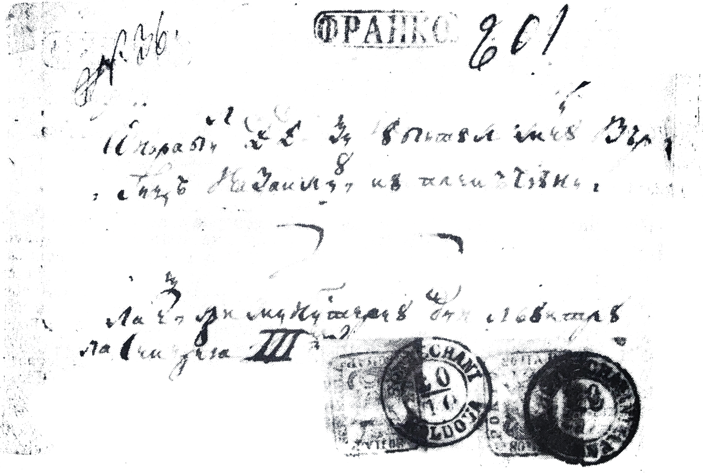

## ⨀ PM52 🌍 Botoşani (Botuschani)

<!-- u:u00749 kind:table -->

| 🎨 Black \| Negru \| Noir \| Schwarz | 🎨 Dark greenish blue \| Albastru verzui închis \| Bleu verdâtre foncé \| Dunkles grünliches Blau |
|---|---|

<!-- u:u00750 kind:quad -->
Letter franked with two reused 80 P. stamps to the detriment of the post office, bearing the PM52 handstamp.

<!-- u:u00751 kind:figure -->

*Figure 170: 1859-01-30 J 📅 ✉ 80 Parale ⨀ PM52 🌍 Botoşani (Botuschani)*
