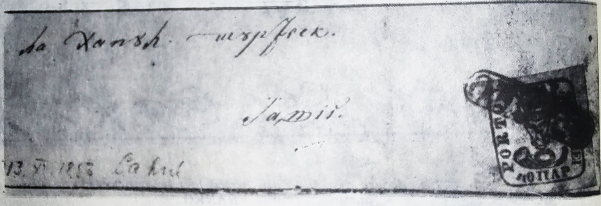

## ⨀ PM52 🌍 Cahul

<!-- u:u00755 kind:table -->

| 🎨 Black \| Negru \| Noir \| Schwarz | 🎨 Dark greenish blue \| Albastru verzui închis \| Bleu verdâtre foncé \| Dunkles grünliches Blau |
|---|---|

<!-- u:u00756 kind:table -->
| A letter stamped with 40P, sent to Iași, addressed "to Hanu Turcesku, Jassi". | O scrisoare cu timbru 40P, trimisă la Iași, adresată: "la Hanu Turcescu, la Iași". |
|---|---|

<!-- u:u00757 kind:figure -->

*Figure 171: 1859-11-13 J 📅 ✉ 40 Parale ⨀ PM52 🌍 Cahul*

<!-- u:u00759 kind:table -->
| Une lettre avec 40P, envoyée à Iași, adressée "à Hanu Turcesku, Iași". | Ein Brief mit dem Poststempel 40P, abgeschickt nach Iași, adressiert "an Hanu Turcescu, Iași". |
|---|---|
