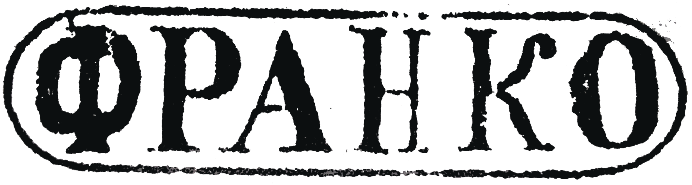
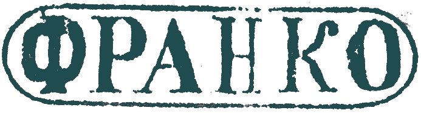
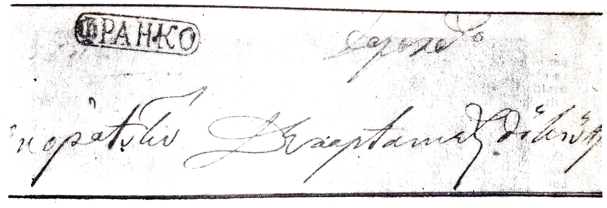

## ⨀ PM52 🌍 Dorohoi (Dorohoj)

<!-- u:u00761 kind:table -->

| 🎨 Black \| Negru \| Noir \| Schwarz | 🎨 Dark greenish blue \| Albastru verzui închis \| Bleu verdâtre foncé \| Dunkles grünliches Blau |
|---|---|

<!-- u:u00762 kind:figure -->

*Figure 172: ⨀ PM52 🌍 Dorohoi (Dorohoj)*
