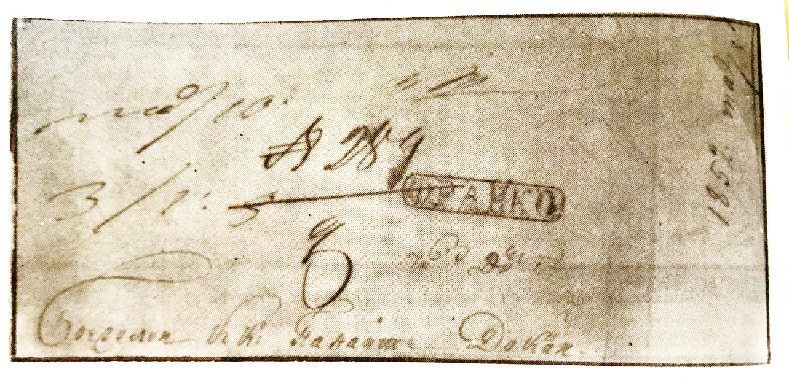
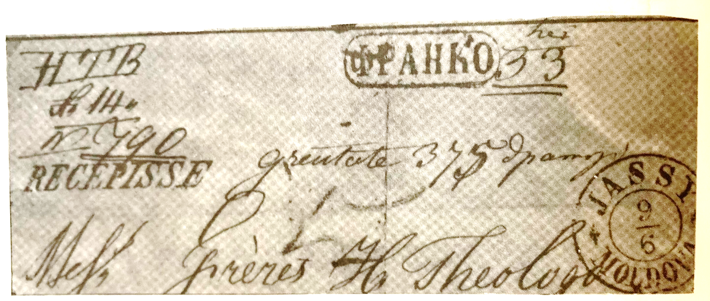

## ⨀ PM52 🌍 Iaşi (Jassy)

<!-- u:u00777 kind:table -->

| 🎨 Black \| Negru \| Noir \| Schwarz | 🎨 Dark greenish blue \| Albastru verzui închis \| Bleu verdâtre foncé \| Dunkles grünliches Blau |
|---|---|

<!-- u:u00778 kind:figure -->

*Figure 173: 1852-03-10 J 📅 ✉ ⨀ PM52 🌍 Iaşi (Jassy) I*

<!-- u:u00781 kind:table -->

| 🎨 Black \| Negru \| Noir \| Schwarz | 🎨 Dark greenish blue \| Albastru verzui închis \| Bleu verdâtre foncé \| Dunkles grünliches Blau |
|---|---|

<!-- u:u00782 kind:figure -->

*Figure 174: 1859-06-09 J 📅 ✉ ⨀ PM52 🌍 Iaşi (Jassy) II*
