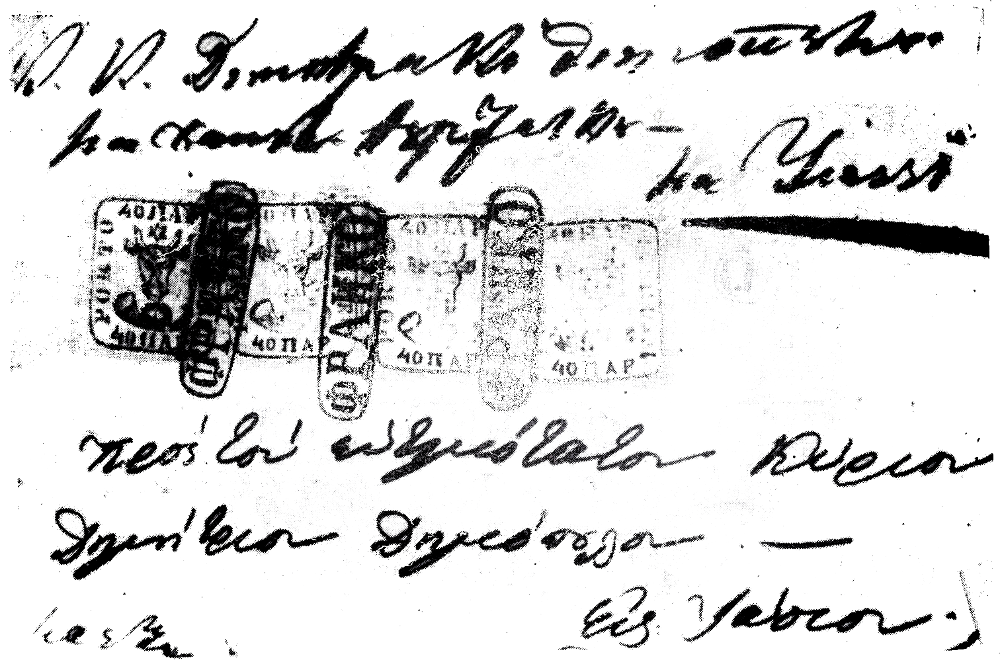

## ⨀ PM52 🌍 Izmail (Ismail)

<!-- u:u00785 kind:table -->

| 🎨 Black \| Negru \| Noir \| Schwarz | 🎨 Dark greenish blue \| Albastru verzui închis \| Bleu verdâtre foncé \| Dunkles grünliches Blau |
|---|---|

<!-- u:u00786 kind:table -->
| A letter stamped with four 40P stamps, sent to Iași, addressed to: "The Honorable Count Dimitraki Dimopolu, at Hanu Turcesku, at Jassi". | O scrisoare ștampilată cu patru timbre de 40P, trimisă la Iași, adresată lui: "C(institul) K(uconului) Dimitraki Dimopolu, la Hanu Turcesku, la Iași". |
|---|---|

<!-- u:u00787 kind:figure -->

*Figure 175: 1859-01-30 J 📅 ✉ 40 Parale ⨀ PM52 🌍 Izmail (Ismail)*

<!-- u:u00789 kind:table -->
| Lettre affranchie avec quatre timbres de 40P, envoyée à Iași, adressée à : "L'Honorable Comte Dimitraki Dimopolu, à Hanu Turcesku, à Jassi". | Ein Brief, gestempelt mit vier 40P-Marken, geschickt nach Iași, adressiert an: "Der ehrenwerte Graf Dimitraki Dimopolu, in Hanu Turcesku, in Jassi". |
|---|---|
