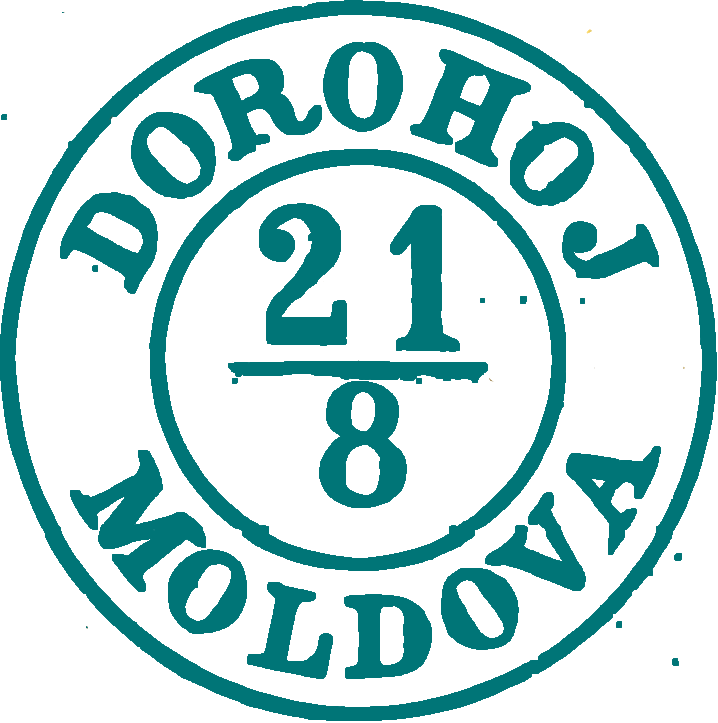
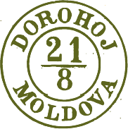
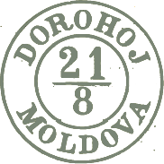

## ⨀ M1 🌍 Dorohoi (Dorohoj)

<!-- u:u00816 kind:table -->

| 🎨 Blueish green \| Verde albăstrui \| Vert bleuté \| Bläuliches grün | 🎨 Verona green \| Verde veronez \| Vert vérone \| Verona grün | 🎨 Dark Greenish \| Verzui închis \| Vertes foncé \| Dunkelgrünes |
|---|---|---|
