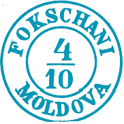
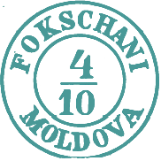
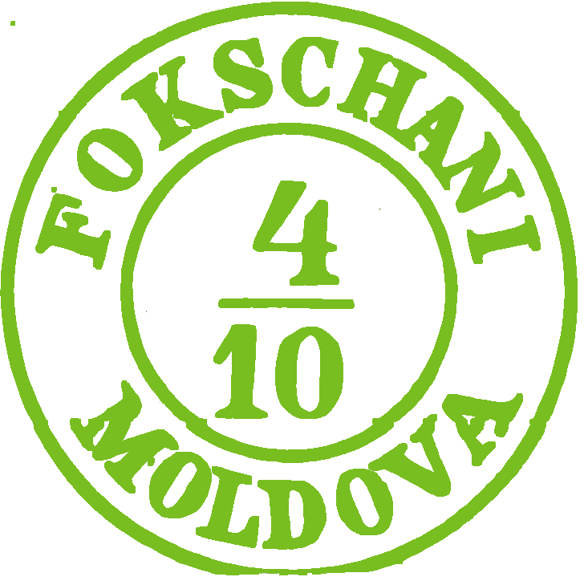

## ⨀ M1 🌍 Focşani (Fokschani)

<!-- u:u00819 kind:table -->

| 🎨 Medium blue \| Albastru mediu \| Bleu moyen \| Mittelblau | 🎨 Greenish blue \| Albastru verzui \| Bleu verdâtre \| | 🎨 Medium green \| Verde mediu \| Vert moyen \| Mittelgrün |
|---|---|---|
