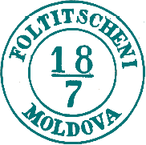
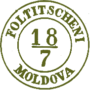

## ⨀ M1 🌍 Fălticeni (Foltitscheni)

<!-- u:u00826 kind:table -->

| 🎨 Blueish green \| Verde albăstrui \| Vert bleuté \| Bläuliches grün | 🎨 Verona green \| Verde veronez \| Vert vérone \| Verona grün |
|---|---|
