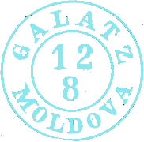
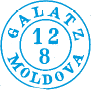
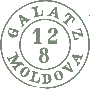

## ⨀ M1 🌍 Galaţi (Galatz)

<!-- u:u00828 kind:table -->

| 🎨 Light blue \| Albastru deschis \| Bleu clair \| Hellblau | 🎨 Medium blue \| Albastru mediu \| Bleu moyen \| Mittelblau | 🎨 Dark Greenish \| Verzui închis \| Vertes foncé \| Dunkelgrünes |
|---|---|---|
