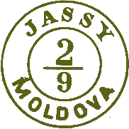

## ⨀ M1 🌍 Iaşi (Jassy)

<!-- u:u00836 kind:table -->

| 🎨 Medium blue \| Albastru mediu \| Bleu moyen \| Mittelblau | 🎨 Blueish green \| Verde albăstrui \| Vert bleuté \| Bläuliches grün | 🎨 Verona green \| Verde veronez \| Vert vérone \| Verona grün | 🎨 Carmine red \| Roşu carmin \| Rouge carmin \| Karminrot |
|---|---|---|---|
| There are two types. Există două tipuri. Il existe deux types. Es gibt zwei Typen. |  |  |  |
|  |  |  |  |
| I | II |  |  |
| 🎨 Carmine red \| Roşu carmin \| Rouge carmin \| Karminrot |  |  |  |
| The red ink was available only between Thursday, 28 August and Saturday 18 October (J). The following dates are valid for ⨀ 🐃 1, and weekends (Saturday and Sunday) are shown on gray background. | Cerneala roșie a fost disponibilă numai între joi, 28 august și sâmbătă, 18 octombrie (J). Următoarele date sunt valabile pentru ⨀ 🐃 1, iar weekend-urile (sâmbătă și duminică) sunt afișate pe fond gri. |  |  |
| L'encre rouge n'était disponible qu'entre le jeudi 28 août et le samedi 18 octobre (J). Les dates suivantes sont valables pour ⨀ 🐃 1, et les week-ends (samedi et dimanche) sont indiqués sur fond gris. | Die rote Tinte war nur zwischen Donnerstag, dem 28. August, und Samstag, dem 18. Oktober, verfügbar (J). Die folgenden Daten gelten für ⨀ 🐃 1, und die Wochenenden (Samstag und Sonntag) sind grau unterlegt. |  |  |

<!-- u:u00838 kind:quad -->
1858-08    J📅
