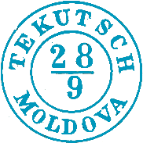
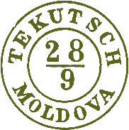

## ⨀ M1 🌍 Tecuci (Tekutsch)

<!-- u:u00857 kind:table -->

| 🎨 Medium blue \| Albastru mediu \| Bleu moyen \| Mittelblau | 🎨 Verona green \| Verde veronez \| Vert vérone \| Verona grün |
|---|---|
