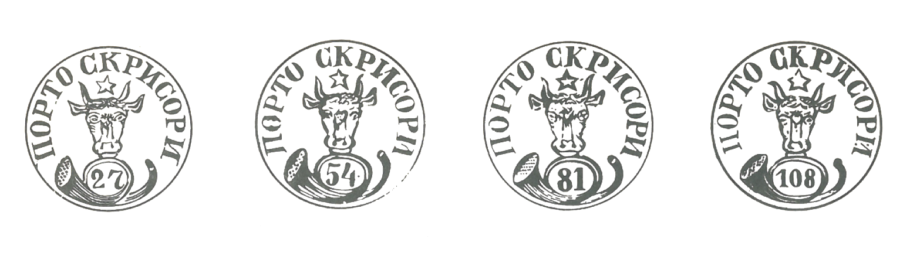

# 🐃 1

<!-- u:u00887 kind:quad -->
For the first "Cap de Bour" (Aurochs’ Head) stamps in Moldavia, an aurochs with a star between its horns was depicted. The auroch is often confused with the bison (see §2, p.17). Below the lower lip of the aurochs is a postal horn with the face value of the postmark written in Arabic numerals in the inner circle. 
These markings are enclosed in a circle which, in the upper part of the interior, above the head of the aurochs, is inscribed in Cyrillic letters PORTO SCRISORI (ПОРТО СКРИСОРИ). "Scrisori" means postal letters in Romanian. Porto means "payable by the addressee", while Franco means "payable by the sender”. Therefore, the use of the word PORTO is a mistake, as the term FRANCO refers to letters in which the stamp was payable by the sender, as was the case with letters using these stamps.

<!-- u:u00888 kind:text -->
19.50 mm                                 19.50 mm                                   19.75 mm                                20.25 mm    19.50 mm                                 19.50 mm                                   19.75 mm                                20.25 mm

<!-- u:u00889 kind:figure -->

*0.76”                                           0.76”                                           0.77”                                       0.79”                                     19.50 mm                                  19.75 mm                                  20.25 mm0.76”                                           0.76”                                           0.77”                                       0.79”                                     19.50 mm                                  19.75 mm                                  20.25 mm*

<!-- u:u00890 kind:text -->
Figure 176: 🐃 1: ∅ & 📯
