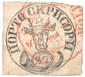
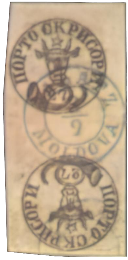
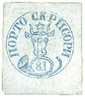
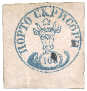

## 🐃 1 📖

<!-- u:u00893 kind:text -->
Catalogue no. | Nr. catalog | Catalogue n° | Katalog-Nr

<!-- u:u00894 kind:table -->

| 💰 | 🐃 | 📖 | 🎨 | 🧻 |
|---|---|---|---|---|
| 27 Parale | ⏭ Figure 196, p.252 | 📖 Kiriac 1 📖 MI 1 📖 SC 1 📖 YT 1 | 🎨 Black \| Negru \| Noir \| Schwarz | Horizontal 🧻 Laid \| Vărgată \| Rayé \| Gestreiftem   🎨 Pale rose \| Roze palid \| Rose pâle \| Blassrosa |
| 27 + 27 Parale tête-bêche | ⏭ Figure 208, p. 256 | 📖 Kiriac 1a 📖 MI 1k 📖 SC 1a 📖 YT 1  ⨀ M1 🌍 Galaţi (Galatz) 3/9  1858-09-03 📅 J 1858-09-15 📅G |  |  |
| 54 Parale |  | 📖 Kiriac 2 📖 MI 2 📖 SC 2 📖 YT 2 | 🎨 Dark blue \| Albastru închis \| Bleu foncé \| Dunkelblau | Horizontal 🧻 Laid \| Vărgată \| Rayé \| Gestreiftem  🎨 Light Greenish \| Verzui deschis \| Vertes clair \| Blassgrünes |
| 81 Parale |  | 📖 Kiriac 3 📖 MI 3 📖 SC 4 📖 YT 3 | 🎨 Dark blue \| Albastru închis \| Bleu foncé \| Dunkelblau | 🧻 Wove \| Simplă \| Ordinaire \| Einfachem  🎨 Pale blueish \| Albăstrui palid \| Bleuâtre pâle \| Blassbläulich |
| 108 Parale |  | 📖 Kiriac 4 📖 MI 4 📖 SC 3 📖 YT 4 | 🎨 Dark blue \| Albastru închis \| Bleu foncé \| Dunkelblau | Horizontal 🧻 Laid \| Vărgată \| Rayé \| Gestreiftem  🎨 Pale red \| Roşu palid \| Rouge pâle \| Blassrot |

<!-- u:u00895 kind:text -->
Table 13: 🐃 1 📖
